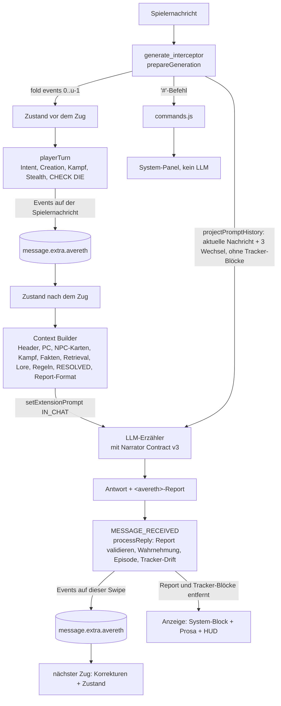

# Avereth: Architekturentscheidung

**Kurzfassung:** Die bisherige Architektur war „alles ist Prompt“: WorldInfo-Engines, Character Description und der Host-Tracker als Zustand. Sie wurde von Grund auf neu bewertet.

Ergebnis ist eine **Hybrid-Architektur (Variante B)**:
- Eine deterministische **Avereth Engine** als SillyTavern-Extension besitzt Regeln, Zufall, Zustand und Figurenwissen. Sie ist in reinem JavaScript geschrieben, hat keine Abhängigkeiten und liegt unter `src/`.
- Das Sprachmodell erzählt, interpretiert Absicht und schlägt neue Erzählfakten vor. Diese laufen durch eine Validierung, bevor sie Kanon werden.
- **Behalten** wurden die Inhalte (Core, Content, Lore, System, First Message) und die Verhaltensregeln der Character Description.
- **Ersetzt** wurde die technische Umsetzung.

## 1. Leitlinie

„Die bisherigen Inhalte sind wertvoll. Die technische Struktur darf vollständig verändert werden.“

Daraus folgt:
- Inhalte (Regeln, Lore, Klassen, Monster, Figuren) bleiben **wörtlich** erhalten. Tests prüfen das.
- Datenmodelle, Speicherung, Ablauf und Prompt-Aufbau sind neu entworfen.

## 2. Anforderungen

Abgeleitet aus Phase 1, den Inhalten und Testrun-v1:

| # | Anforderung | Beleg |
|---|---|---|
| R1 | Exakte Mechanik, **echter Zufall**, vollständige Kampf-Zustandsmaschine | Testrun: „say 44“, DefeatXP fehlt, keine Zugreihenfolge |
| R2 | Kanonischer Zustand jenseits des Kontextfensters: PC, Inventar, Coin, Skills, Quests, NPCs, Orte, Fraktionen, Weltfakten, Beziehungen, Zeit | Testrun: Snapshot verloren, Coin-Feld fehlt |
| R3 | Getrennte Epistemik: Weltwahrheit, Figurenwissen, Überzeugung, Erinnerung, Erzählung. NPCs sind nicht allwissend. | Testrun: „boy“-Leck |
| R4 | Langzeit-Episodengedächtnis mit Retrieval | lange Kampagnen, Wiedersehen nach Wochen |
| R5 | Kontext-Ökonomie: nur Relevantes, keine lexikalischen Fehltreffer | Testrun: #3/#4 auf Host-Text, START mit 30 fremden Aktionen |
| R6 | Host-Unabhängigkeit: Megumin optional, keine Formatvorgaben | Nutzerprinzip aus Phase 1 |
| R7 | Spieler-Agency | CD-Regeln wirken nachweislich |
| R8 | Modellunabhängigkeit, tolerantes Parsen | GLM über Custom-Endpoint, JSON-Schema-Support unklar |
| R9 | Konsistenz bei Swipe, Regenerate, Delete und Edit | SillyTavern-Alltag |
| R10 | Audit, Debugging, Retcon | Würfel und Rechenwege müssen prüfbar sein |
| R11 | Quellen zuerst: Daten aus einer Quelle, Schemas, Tests | Phase-1-Prinzip |
| R12 | Latenz: keine Pflicht-Zusatzaufrufe ans LLM | Testrun: 37–165 s pro Zug |
| R13 | Kein Overengineering: kein Server, keine Datenbank, keine Abhängigkeiten | Einzelnutzer, SillyTavern |
| R14 | Content-Lücken schließen, nicht improvisieren lassen | Trapper-Profil improvisiert, Ambush ohne Zustand |

## 3. Recherche

Primärquellen, soweit erreichbar. arXiv und einige Doku-Seiten waren durch die Netzwerkrichtlinie gesperrt. Dort stützt sich die Bewertung auf Suchzusammenfassungen und öffentliche Repositories.

| System / Arbeit | Kernidee | Übernommen | Nicht übernommen |
|---|---|---|---|
| **SillyTavern** (Quellcode: `script.js`, `extensions.js`, `st-context.js`, `events.js`; Doku „Writing Extensions“) | `generate_interceptor`, `setExtensionPrompt`, Events; `message.extra` wird pro Swipe kopiert (`syncMesToSwipe`/`syncSwipeToMes`) | Engine als Extension; Events pro Nachricht in `message.extra.avereth` (swipe-sicher); Injektion per Extension-Prompt | Speicherung in WorldInfo-Einträgen |
| **Generative Agents** (Park et al. 2023, arXiv 2304.03442; `joonspk-research/generative_agents`, `retrieve.py`) | Memory-Stream pro Agent, Retrieval = Recency + Importance + Relevance | Gedächtnis pro Figur mit Zeugen; Scoring aus Recency, Importance, Relevanz | Embeddings als Pflicht (Namen und Orte sind exakte Schlüssel; Vektor-Hook optional) |
| **MemGPT / Letta** (arXiv 2310.08560) | Hauptkontext, Recall- und Archivspeicher; das LLM verwaltet sein Gedächtnis per Funktionsaufruf | Trennung „immer im Kontext“ und „abrufbar“ | Gedächtnisverwaltung durch das LLM (Aufrufkosten, Unzuverlässigkeit) |
| **LangGraph Memory**, **LlamaIndex Memory** | Kurzzeit (Thread-State) und Langzeit-Store; Memory-Blöcke mit Prioritäten unter Token-Limit | priorisierte Sektionen unter Budget | Framework-Abhängigkeit, Python-Server |
| **Graphiti / Zep** (arXiv 2501.13956) | temporaler Wissensgraph; Fakten mit Gültigkeitsfenster; ungültig machen statt löschen | Fakten mit `since`/`until`; Historie bleibt; Graph aus Fakten und Relationen | Graph-DB (Neo4j), LLM-basierte Widerspruchserkennung |
| **Mem0** | Extraktion, Entity-Linking, hybrides Retrieval (semantisch, BM25, Entität) | hybrides Scoring mit BM25 und Entitäten | Cloud/Vector-DB |
| „Verbatim Chunks Beat Extracted Artifacts“ (arXiv 2601.00821) | Wörtliche Textstücke schlagen reine LLM-Extraktion | Episoden-Einträge mit dem wörtlichen Spielertext ergänzen die strukturierten Fakten | reine Extraktion |
| **SillyTavern World Info** (Quellcode `world-info.js`: `checkWorldInfo`, `WorldInfoBuffer`; Doku-Repo `SillyTavern-Docs`) | Schlüssel-Aktivierung über die letzten n Nachrichten; Order, Rekursion, hartes Budget (der erste Überlauf beendet die Liste); Extension-Prompts mit `scan` werden mitdurchsucht | beschreibende Welt-Lore als Character Lore der Erzähler-Karte; Lore-Bridge (Realm und Stadt, Position NONE, `scan`); Trigger-Audit gegen die echten Testruns ([LOREBOOK.md](LOREBOOK.md)) | Regeln und Zustand per Schlüsselwort; Rekursion |
| **AI Dungeon** (Memory System, Story Cards), **NovelAI** (Lorebook) | Auto-Zusammenfassung, Memory Bank; Keyword-Karten mit Budget | Budgetierung pro Sektion | reine Keyword-Aktivierung (siehe Testrun-Fehltreffer) |
| **Inworld**, **Convai** | Figurenwissen persönlich oder allgemein; Knowledge Bank pro Figur; Narrative Design als Zustandsmaschine | Wissenskarten pro NPC; Quests und Threads als Zustand | proprietäre Plattform |
| **Talemate** | mehrere Agenten, World-State-Manager, Zeitverfolgung | Zeit und Weltzustand als Daten | mehrere LLM-Aufrufe pro Zug |
| **Talk of the Town** (Ryan et al., Game AI Pro 3, Kap. 37) | Überzeugungen aus Beobachtung, Bericht und Irrtum; Überzeugungsfacetten mit Vorgänger | Wissen mit Quelle (`witnessed`, `told:X`, `rumor`, `inferred`) und Vorgänger; falsche Überzeugungen als Claims | vollständige Simulation von Vergessen und Verbreitung |
| **TimeChara** (arXiv 2405.18027), **FANToM** (arXiv 2310.15421) | LLMs verletzen Wissensgrenzen und Theory of Mind systematisch | explizite Wissensgrenzen im Prompt statt Vertrauen auf das Modell | – |
| **FIREBALL** (arXiv 2305.01528), **RPGBench** (arXiv 2502.00595), PANGeA (arXiv 2404.19721), „Can LLM Agents Stick to the Script?“ (arXiv 2608.08160) | Mit echtem Spielzustand sind LLM-Züge besser; ohne ihn ist die Mechanik unverifizierbar; Erzähler widersprechen Fakten | Zustand plus Validierung; harte Fakten | – |
| **Lost in the Middle** (arXiv 2307.03172), **Context Rot** (Chroma 2025), Anthropic „Effective context engineering for AI agents“ | Leistung sinkt mit Länge und Mittelposition; kleinste Menge hochrelevanter Token; Retrieval zur richtigen Zeit | kompakter Block; RESOLVED zuletzt; Regeltexte nur situativ; #system mit Absatz-Retrieval | – |
| **Event Sourcing** (Fowler; Azure Architecture Center) | Append-only-Events, Zustand durch Replay, Snapshots | Zustand = fold(Events); Reducer würfelt nie | eigener Event-Store |
| ST-Umfeld: MVU/MagVarUpdate (Tavern Helper), MultihogDnDFramework, SillyNPC, SimTracker, Megumin Suite | Variablen pro Nachricht; LLM schreibt Updates; vorab gewürfelte Würfel; Hintergrund-Extraktion | Zustand pro Nachricht; vorab festgelegter Würfel (CHECK DIE); zweiter Extraktionspass als spätere Option | vom LLM geschriebene Zustandsänderungen ohne Validierung; Drittabhängigkeiten |

## 4. Speicheroptionen

| Option | Bewertung für Avereth |
|---|---|
| JSON-Dateien (Content) | **ja**: statischer Inhalt, versionierbar, per Schema prüfbar |
| JSONL / Event-Log | **ja**: Events pro Nachricht im Chat; SillyTavern speichert den Chat ohnehin als JSONL. Swipe-, Lösch- und Edit-Semantik gibt es dadurch gratis. |
| SQLite / relational | nein: nicht im Browser-Kontext von SillyTavern, braucht Server oder WASM. Kein Nutzen bei Einzelnutzer-Mengen: 16.000 Events falten in etwa 30–50 ms, der Kontextaufbau braucht etwa 70–120 ms (gemessen, Test `large history`). |
| Graph-Datenbank | nein als Infrastruktur; **ja als Modell**: Fakten (s, p, o) und Relationen sind ein kleiner temporaler Graph im Zustand |
| Vektor-Datenbank | nicht nötig: Retrieval-Schlüssel sind Namen, Orte, Quests und Beziehungen. BM25 deckt freie Formulierungen ab. `rank()` hat einen `semantic`-Hook für Embeddings. |
| **Gewählt: Hybrid** | Content als JSON, Kampagne als Event-Log pro Nachricht, Zustand als In-Memory-Fold, Retrieval über strukturierte Signale plus BM25 |

## 5. Varianten und Trade-offs

- **A – WorldInfo-only, weiter optimiert:** die bisherige Linie mit besseren Schlüsseln, kleineren Engines und strengerem Tracker.
- **B – Hybrid:** deterministische Engine als ST-Extension, dazu LLM-Erzähler, validierter Fakten-Report und Kontext-Builder. **Gewählt.**
- **B-lite:** MVU/Tavern Helper. Das LLM schreibt Variablen-Updates, EJS-Templates wählen Inhalte, Zod-Schema.
- **C – Externer Dienst:** Server mit Datenbank und Agenten (Erzähler, Regelagent, Extraktor), angebunden als Proxy.
- **D – Tool-Calling:** Das LLM ruft während der Generierung Engine-Tools auf (`roll`, `attack` …), über den ToolManager von SillyTavern.

| Kriterium | A | **B** | B-lite | C | D |
|---|---|---|---|---|---|
| Konsistenz (Regeln, Zustand) | niedrig: Testrun-Fehler strukturell | **hoch**: Code plus Validierung | mittel: LLM schreibt Zustand | hoch | mittel: LLM entscheidet, **ob** es aufruft |
| Langzeitgedächtnis | niedrig: nur Kontextfenster und letzter Tracker | **hoch**: Event-Log plus Retrieval | mittel: Variablen, kein Retrieval | hoch | mittel |
| Skalierbarkeit (1.000+ Züge) | niedrig | **hoch**: Fold linear, Kontext budgetiert | mittel | hoch | mittel |
| Tokenverbrauch pro Zug | hoch: 5,6–9k Avereth-Anteil | **niedrig**: Contract ~4,0k + Block ~1,0–1,3k | mittel | mittel | mittel bis hoch (Tool-Schemas, Runden) |
| Retrieval-Qualität | niedrig: lexikalisch, Fehltreffer | **hoch**: zustandsgesteuert plus kuratierte Schlüssel | niedrig | hoch | – |
| Wartbarkeit | mittel: 124k Zeichen Prompt-Regeln | **hoch**: Daten mit Schema, Code mit 143 Tests | mittel | niedrig: Betrieb | mittel |
| Erweiterbarkeit | niedrig: jede Regel kostet Prompt | **hoch**: Daten und Code | mittel | hoch | mittel |
| Debugging | niedrig: Reasoning lesen | **hoch**: #audit, Event-Export, deterministische Replays | mittel | mittel | mittel |
| Komplexität | niedrig | **mittel**: etwa 4.000 Zeilen JS, keine Abhängigkeiten | mittel: zwei Fremd-Extensions | hoch | mittel |
| Robustheit in langen Kampagnen | niedrig: Single Point of Failure Tracker | **hoch**: Replay, Invarianten, Swipe-Sicherheit | mittel | hoch | niedrig bis mittel |
| Modellunabhängigkeit | mittel | **hoch**: nur Text rein, tolerantes JSON raus | mittel | hoch | niedrig: Tool-Support je Endpoint |
| Latenz | 1 Aufruf | **1 Aufruf** | 1 Aufruf | 2–3 Aufrufe | 2+ Runden |

**Warum nicht A:** Die Testrun-Fehler sind strukturell, nicht redaktionell. Würfel, Persistenz und Prozedurtreue lassen sich nicht herbeiprompten.

**Warum nicht B-lite:**
- Bewährtes Muster, aber das LLM schreibt die Zustandsänderungen selbst, also genau die fehleranfällige Stelle.
- Zwei Drittabhängigkeiten.
- Kein Würfel-, Kampf- und Wissensmodell.

**Warum nicht C:**
- Server und Betrieb sind überdimensioniert für einen Einzelnutzer.
- Ein Proxy sieht Swipes, Edits und Deletes nicht.
- 2–3 LLM-Aufrufe pro Zug bei ohnehin 37–165 s Latenz.
- Die Integration in SillyTavern und Megumin ginge verloren.

**Warum nicht D:**
- Tool-Calling hängt vom Endpoint ab; beim GLM-Custom-Endpoint ist es unklar.
- Mehrere Runden kosten Latenz.
- Vor allem entscheidet wieder das LLM, **ob** es die Regel anwendet. Genau das ist im Testrun gescheitert.

## 6. Entscheidung

**Variante B.** Aufteilung der Verantwortung:

| Aufgabe | Wer | Warum |
|---|---|---|
| Absicht erkennen (Angriff, Skill, Ziel, Bewegung, Schleichen, Befehl) | Engine (Regex und Zustand), 40/40 Angriffs- und 34/34 Nicht-Angriffs-Formulierungen aus dem v1.24-Korpus | deterministisch, testbar; Fragen und zitierte Drohungen sind keine Festlegung (Core #23) |
| Regeln, Würfel, Kampf, XP, Level, Coin, Munition | Engine | Testrun: LLM würfelt nicht und überspringt Schritte |
| Menschliche NPC-Profile, Monsterprofile | Engine (Vorlagen und Anker), einmal gesperrt | Testrun: improvisiertes Profil |
| Wissen, Erinnerung, Identität der NPCs | Engine-Modell; der Narrator schlägt Änderungen vor | Wissensgrenzen per Konstruktion |
| Erzählung, Dialog, Weltreaktion | LLM | seine Stärke |
| Neue Figuren, Orte, Fakten, Beziehungen, Quests | LLM schlägt per `<avereth>`-Report vor, die Engine validiert | Erzählung erzeugt Welt, aber nicht ungeprüft |
| Nicht-Kampf-Checks | LLM entscheidet den Check-Gate (Core #7), die Engine liefert den **CHECK DIE** und prüft die Rechnung | Core überlässt die Situationsbewertung dem Narrator; der Wurf bleibt Engine-Sache |

## 7. Überblick und Datenfluss



**Runtime V3** ([RUNTIME_V3.md](RUNTIME_V3.md)):
- Der Zustand hat eine einzige Quelle, den Fold der Events.
- Charakter- und Welt-HUD sind reine Ansichten davon (`hud.js`, `extra.display_text`). Sie gehen nie in den Prompt.
- Das Modell schreibt keine Tracker, Charakterbögen, World-States oder NPC-Dossiers mehr. Der Fakten-Report meldet nur Deltas.
- Der Interceptor kürzt die Prompt-Kopie des Verlaufs (`coreChat`) auf ein Fenster und entfernt alte Blöcke. Der gespeicherte Chat bleibt unverändert.
- Die Charaktererstellung ist ein Menü. Die Engine beantwortet sie wie einen `#`-Befehl als System-Panel, ohne Erzähler ([PRETEST5_DIAGNOSE.md](PRETEST5_DIAGNOSE.md)).

**Komponenten** (`src/`):

| Modul | Aufgabe |
|---|---|
| `state.js` | Reducer: Zustand = fold(Events); würfelt nie; unbekannte Events werfen einen Fehler |
| `rng.js` | zählerbasierter Zufall `uniform(seed, n)`: dieselbe Eingabe ergibt dieselben Würfe; Regenerieren würfelt nicht neu |
| `content.js`, `derived.js`, `creation.js`, `npcgen.js`, `progression.js`, `economy.js` | Regeln und Inhalte |
| `combat.js` | Initiative (⌊1,5 × AGI⌋), Zugschleife, Schadenskette (Core #11; jeder legale Angriff trifft, Crit nur im echten Hinterhalt, Partial Cover und Verteidigungs-Minderung), Reichweiten, Munition, Effekte, NPC-Verhalten, Kampfende |
| `checks.js` | Checks (Core #7/#8), Schleichen gegen Wahrnehmung |
| `intent.js` | Absicht aus der Spielernachricht |
| `knowledge.js` | Fakten mit Gültigkeit, Wissen, Claims, Erinnerungen, Identität |
| `delta.js` | Fakten-Report parsen und validieren |
| `retrieval.js`, `context.js` | Scoring, Packen, Engine-Block (NPC-Karten, situatives Report-Schema) |
| `hud.js` | Charakter- und Welt-HUD aus dem Zustand (nur Anzeige) |
| `commands.js` | #-Befehle |
| `validate.js` | Invarianten, JSON-Schema |
| `engine.js` | Fassade |
| `host.js` | SillyTavern-Chat-Adapter, Prompt-Projektion des Verlaufs |

## 8. Trennung von Weltwahrheit, Wissen, Überzeugung, Erinnerung und Erzählung

| Ebene | Speicher | Wer sieht es |
|---|---|---|
| **Weltwahrheit** | `facts` {s, p, o, since, until, visibility, hard}; `entities` (Status, Profil) | Erzähler (ESTABLISHED FACTS, RELEVANT); NPCs **nicht** |
| **Figurenwissen** | `knowledge[who][factId]` mit Haltung `knows`/`suspects` und Quelle | nur die jeweilige NPC-Karte |
| **Überzeugung** | `claims` (können falsch sein) plus `knowledge` mit Haltung `believes` | NPC-Karte, markiert „actually FALSE“ |
| **Erinnerung** | `memories` mit `who`, `witnesses`, `seen` (wer Alaric dabei sah) und `{pc}`-Platzhalter. Zeugen sind die Beteiligten (`who`), vom Erzähler genannte (`witnesses`) oder bei `public` alle Anwesenden, die nicht `unaware` sind. **Anwesend ist nicht wahrnehmend**, auch bei Kampftod und Kampferinnerung. Nach einem Ortswechsel (`place`) bleibt nur in der Szene, wen der Report dort platziert; alle anderen bleiben zurück (Testrun 2: ein Trapper auf LONG; Testrun 3: Fuhrmann und Registrarin „folgten“ in einen Keller und bezeugten dort einen Kampf). | nur Zeugen; Formulierung je Betrachter („someone unseen“, „the stranger“, „Alaric“) |
| **Erzählung** | der Chattext selbst | wird nie als Wahrheit gelesen, nur über validierte Reports |

Folgen:
- Ein NPC kennt Alarics Namen nur, wenn er ihn gesagt bekam, per Selbstvorstellung oder als `learn` mit Quelle.
- Er kennt sein Aussehen nur, wenn er ihn unverdeckt sah (Wahrnehmung am Zugende).
- Geheimnisse verbreiten sich nur durch Erzählen oder Beobachten, nicht als Gerücht.
- Lernen kann die Weltwahrheit nie ändern. Nur `witnessed` durch einen Anwesenden legt einen neuen Fakt an. Gehörtes (`told`, `rumor`, `public`) ohne bekannten Fakt wird ein **Claim** mit Wahrheit `unknown` (oder `false`, wenn es einem funktionalen Fakt widerspricht); die Figur glaubt oder vermutet ihn.
- Weltänderungen machen altes Wissen „OUTDATED“, statt es zu löschen.

## 9. Event-System

Alle 42 Event-Typen sind in `schemas/event.schema.json` und [DATENMODELL.md](DATENMODELL.md) beschrieben. Grundsätze:
- Append-only pro Nachricht; Zustand = fold.
- Der Reducer würfelt nie; Würfe stehen in den Events (`rng_to`).
- Ein Swipe hat eigene Events.
- Ein Delete entfernt die Events der gelöschten Nachricht.
- Eine editierte Antwort behält ihre Fakten (Tippfehler, Umformulierung). **Retcon:** Enthält der editierte Text einen neuen `<avereth>`-Block, wird die Antwort neu validiert und ihre Events ersetzt (`{}` = keine Fakten). Das gilt nur für die neueste Antwort: Spätere Züge wurden gegen ihre Fakten aufgelöst und werden nicht neu abgespielt. Bei älteren Antworten bleiben die Fakten, und die Extension verlangt, erst die späteren Nachrichten zu löschen.
- Ein Replay ist deterministisch: Test „fold(event log) === live state“.

## 10. Retrieval und Context Builder

**Score eines Kandidaten** (Erinnerung, Fakt, Quest, Thread):

```
3·Entität + 1,5·Ort + 1,5·Quest + 0,5·0,99^Alter + 2·Wichtigkeit + 2·BM25 + 1·Beziehung
```
(+ optional semantisch)

Seit 4.3.0-c.6.6.9 (Patch 1, Live-Lauf 18.10.2026) gilt für die Signale:
- **Anfrage:** BM25 bewertet die Spielernachricht voll. Aus der letzten Antwort zählen nur die bekannten Namen, die sie erwähnt (Personen, Orte, Quests), plus die Namen der Anwesenden, jeweils mit halbem Gewicht. Vorher ging die ganze Antwort (1.500 Zeichen) in die Anfrage ein.
- **BM25-Kurve:** `1 − e^(−BM25/6)` statt `min(1, BM25/6)`. Starke Treffer bleiben unterscheidbar, statt bei 1 gleichzuziehen.
- **Entität:** Alaric (`pc`) ist kein Fokus mehr, weil er in fast jeder Erinnerung vorkommt. Fokus sind die Anwesenden und die NPCs, die die Spielernachricht oder die letzte Antwort namentlich nennt.
- **Gleiche Zeilen:** Wortgleiche Zeilen gleicher Art (gleiche Zeit, gleicher Text) erscheinen einmal mit `(×n)`. Das Event-Log bleibt unverändert.

Seit 4.3.0-c.6.6.10 (Patch 2) gilt für Threads, Ziele und Berichtsorte:
- **Threads** tragen eine Engine-ID (`thread.t<Zug>.<n>`) und den Ort, an dem sie entstanden (`src/threads.js`, gemeinsam für V3 und V4). Ein Bericht ohne ID trifft denselben offenen Thread bei gleichem Wortlaut oder bei einer Umformulierung mit ≥ 60 % Wortüberschneidung, wenn genau ein Kandidat passt. Abschließen geht nur für einen bekannten Thread, mit Beleg in der Antwort. Zeichen und lokale Gefahren (`sign`, `threat`) sind nach 6 h an einem anderen Ort oder nach 3 Tagen „nicht mehr aktuell“. Das ist eine Sicht, kein Event: Nichts wird geschlossen, und am Ort sind sie wieder aktuell. Im Retrieval stehen aktuelle Threads mit Wichtigkeit 0,7, die übrigen mit 0,2 und dem Vermerk „Resolved thread“ bzw. „Earlier sign … no longer current“.
- **Ziele** (`intents`, nur V4) stehen als eigener Abschnitt `goals` (Priorität 1, höchstens 3 Zeilen) im Engine-Block, mit dem Hinweis, dass sie nie Grund sind, für Alaric zu handeln.
- **Berichtsorte** (`places[id].known = reported`) stehen im Katalog mit ihrem Bericht („known only by report … not seen yet“). Ihre Angaben werden keine Fakten.

Seit 4.3.0-c.6.6.11 (Patch 3) schützt die Firewall zusätzlich den mechanischen Zustand (`src/v4/firewall.js`):
- **Leben und Tod** einer Kreatur oder Person mit Kampfwerten gehören der Engine. Eine widersprechende Behauptung wird abgewiesen (mit Korrektur), eine wiederholende nicht erneut gespeichert.
- **Alarics HP, MP, STA, Level und Ausrüstung** sind keine freien Fakten. Eine Wunde bei voller HP wird abgewiesen; eine Wunde bei verletztem Alaric lebt nur bis zur Heilung (`scope.hurt`).
- **Alarics eigene Taten** (gegessen, gejagt, gekauft, verbraucht, zurückgelassen) sind keine Fakten; sie entstehen nur aus seinen Befehlen. Hat er sie nicht befohlen, sagt die nächste Korrektur, dass sie nicht geschehen sind.
- **Beträge** liest die Engine aus dem Wortlaut (`said`, sonst Einheitenfehler gegenüber im Text genannten Beträgen); ein übermittelter Betrag weicht nicht unbemerkt vom Text ab.
- In Fakten gezeigte Kreaturen gleichen Aussehens tragen beim Lesen ihren Szenen-Handle („Wolf B“).

Seit 4.3.0-c.6.6.12 (Patch 4) hält der V4-Weltpfad Gruppen und Kampfkontinuität zusammen (`src/v4/world.js`, `src/engine.js`, `src/combat.js`):
- **Gruppen** sind ihre Einzeltiere: Eine `creature.new`-Gruppe bekommt einzelne Entities mit Gruppenname (`entity.group`), den auch der Katalog zeigt. Eine anwesende Gruppe nennt der Extraktor mit ihrem Namen als `ref`: `more:false`/`null` = diese Gruppe erneut, `more:true` = Neuzugänge, die ihr beitreten (fortlaufend nummeriert). Unter eigener `ref` ist `more:true` eine neue Gruppe oder ein einzelner Neuankömmling; `more:false` meint die Tiere dieser Art hier nur, wenn sie eine einzige Gruppe sind. In jedem anderen Fall rät die Engine nicht nach Artgleichheit, verschmilzt und verdoppelt nichts (`group_unclear`) und sagt es dem Erzähler. Ein Neuzugang, der in einen laufenden Kampf eingreift, bleibt neu.
- **Gruppenreferenzen** in `hostile`, `intent` und `aware` („the wolves“, „the pack“, die Ref der Gruppe) meinen jedes lebende Mitglied hier, auch eine zuvor friedliche Gruppe (`threat: false`); ob jemand angreifen darf, entscheidet danach die World Envelope. Eine Art oder ein Kollektiv über zwei Gruppen ist niemand Bestimmtes. Ausgenommen sind Mitglieder, denen dieselbe Antwort etwas anderes zuschreibt (Flucht, Zurückhalten). Eine Zahl, die nicht zur Gruppe passt („two wolves“ von vier), bindet niemanden; der Erzähler erhält eine Korrektur.
- **Wachsamkeit:** Wer gegen Alaric gekämpft oder seinen Kampf beobachtet hat, ist eine Weile wachsam (`entity.wary`, `rules.combat.wary_min`). Ein erzähltes „unaware“ gibt dann keinen Hinterhalt; nur seine eigene Schleichprobe oder ausreichend Zeit tun das.
- **Flucht:** Wer in seinem letzten Zug geflohen ist, flieht weiter, bis er den Kampf verlassen hat. Wird er eingeholt, kämpft er.
- **Erzählerblock:** Kreaturen, die anwesend, aber nicht im Kampf sind, stehen als „Here but NOT in the fight“ im Kampfblock.

Seit 4.3.0-c.6.6.13 (Patch 5) ist eine Reise eine zusammenhängende Unternehmung auf denselben Bausteinen (`src/v4/commands.js`, `src/v4/world.js`, `src/v4/intents.js`):
- **Ziel und Fortsetzung:** Das Ziel bleibt in `s.intents`, bis er ankommt, es aufgibt oder ersetzt. Ein offenes „bis ich ein Dorf finde“ wird ein Ziel ohne Ort (`seek`), sobald er dafür auf der Straße ist; „I continue“ setzt es mit seinen ursprünglichen Worten zum Weg fort. Ein Ort, den die Erzählung nur nennt oder zeigt, ist keine Ankunft.
- **Etappen:** Jede Etappe ohne Ankunft auf der Reichsstraße bewegt die Szene weiter; Mitreisende (der Schützling einer laufenden Questreise, `go.along`) kommen mit und kommen auch an, alle anderen bleiben, wo sie waren (`entity.left`).
- **Die Straße:** Für Etappen jenseits der Siedlung entscheidet die Engine nur, ob diese Etappe eine konkrete Unterbrechung bringen darf (`rules.travel.leg_event_pct`, deterministisch aus Seed und Zug), und sagt es dem Erzähler in einer ROAD-Zeile. Auf einer ruhigen Etappe greift niemand an, den die Antwort neu bringt. Wer von einer Unterbrechung noch da ist, ist noch da; nichts Neues kommt hinzu.
- **Dieselben Individuen:** Dieselbe Art am selben Ort kurz danach (fester Ort: `wary_min`; Straße: nur in derselben Antwort) sind die Zurückgelassenen mit ihren HP; sonst andere. Neue Tiere erhalten nie die Ref oder den Gruppennamen früherer.
- **Gruppenposition:** `position` mit einer Gruppen-Ref bewegt jedes Mitglied; mehrdeutige Referenzen bewegen niemanden.

Seit 4.3.0-c.6.6.14 (Patch 6) sind Hindernisse und Gefahren eines Ortes spielbar (`src/v4/features.js`, `src/v4/commands.js`, `src/engine.js`):
- **Merkmale (`s.features`):** Die Erzählung etabliert ein Hindernis oder eine Gefahr (Extractor-Delta `feature`) mit Ort, Art, ob verborgen, was es verlangt (Stat), wie schwer (Difficulty) und ob es verletzen kann. Diese Werte stehen fest, bevor jemand es versucht. Erneut genannt (per ID oder mit seinen eigenen Worten) ist es dasselbe Merkmal. Nur die Engine setzt „überwunden“ (`passed`), „entschärft“ (`disabled`) oder „gefunden“; die Welt selbst darf es zerstören (`destroyed`).
- **Versuche (`attempt`, Planner):** Untersuchen ohne Wurf; Überwinden oder Entschärfen mit einer Engine-Probe (`resolveCheck`, Stat gegen Difficulty Score), gewürfelt vor der Erzählung, im Turn-Record gespeichert (Swipe-stabil). Ein passendes Werkzeug, das er hält, macht es eine Stufe leichter (Werkzeug bleibt, Verbrauchsgut wird verbraucht). Unmögliche Wege: kein Wurf; triviale: Erfolg ohne Wurf. Misserfolg an einer Gefahr kostet den Schaden aus `rules.exploration.harm` (HP nie unter 1 durch Ortsgefahren).
- **Verborgene Gefahren:** Nur Erzähler und Extractor sehen sie. Sie lösen nur durch seine Handlung aus: Betreten bei `enter` (gewürfelt beim GO, gebucht erst mit der bestätigten Ankunft dort), Hantieren bei `touch` oder Überqueren bei `cross` (nur an dem Merkmal, zu dem sie gehören: `on`). Die Engine würfelt seine Reaktion, bucht den Schaden einmal und markiert die Falle als ausgelöst und bekannt.
- **Suche:** Eine erfolgreiche Suche findet ein verborgenes Merkmal des Ortes (die Engine nennt es). Ein Misserfolg ist „nichts gefunden“, keine falsche Spur. Dieselbe Suche am selben Ort ohne echte Zustandsänderung dort (gefunden, überwunden, entschärft, zerstört, neu; Ansehen zählt nicht) und ohne neues Werkzeug ist kein neuer Wurf und kein neuer Fund (`s.searches`).
- **Skills auf Merkmale:** `ability_world` auf ein Merkmal ist eine Engine-Probe mit dem Hauptstat des Skills; Erfolg entschärft es dauerhaft. Ein bereits entschärftes oder zerstörtes Merkmal kostet nichts und bringt nichts.

Seit 4.3.0-c.6.6.15 (Patch 7) sind Dungeons zusammenhängende Orte (`src/v4/dungeon.js`, `src/v4/world.js`, `src/v4/commands.js`):
- **In Räumen erkundbar ≠ Dungeon (Review 4.3.0-c.6.6.16):** Das äußerste Gebäude oder die äußerste Höhle eines Raumkomplexes (eine `site`- oder `interior`-Kette) trägt `rooms: true` (Navigation); seine Räume sind die Orte darunter. Ein **echter Dungeon** trägt zusätzlich `dungeon: {real, theme, rank, levels, control, hidden, guild, heard}`: eigene Ökologie (Theme), eigener Gefahrenrang F–S oder Rang-Bereich, Ränge einzelner Ebenen, wer den Zugang hält. Ein gewöhnlicher Wachturm nutzt dieselbe Navigation, ist aber kein Dungeon. Es gibt keine eigene Registry und keine neue Ortsart. Markiert wird der Komplex durch das Extractor-Delta `passage`. Außerdem markiert ihn der erste Gang zwischen zwei Räumen eines Komplexes in der Wildnis; vorher gegangene Wege übernimmt die Engine aus `scene.history`. Gebäude in Siedlungen werden nie automatisch Dungeons.
- **Raumidentität:** Ein neu genannter Raum liegt im Dungeon, nicht in dem Raum, aus dem er genannt wird (außer der Extractor nennt ausdrücklich einen Elternraum). Wiedererkannt wird er im ganzen Dungeon über Namen und, wo bekannt, Ebene. Der gleiche Name in einem anderen Dungeon ist ein anderer Raum. Ein gleichnamiger Raum am anderen Ende einer Treppe ist ein anderer Raum. Zwei gleichnamige Räume ohne Unterscheidungsmerkmal sind eine Rückfrage. Die Realm-weite Namenssuche (Patch 2) gilt in Dungeons nicht.
- **Wege (`s.links`):** `{a, b, name, both, hidden, feature, dir}`. Zwei Räume können mehrere Wege verbinden (Eisentür und Lüftungsschacht); ein Bericht meint den Weg seines Namens (`sameWay`), ein GO durch einen benannten Weg nimmt genau diesen (die verschlossene Tür bleibt verschlossen, auch wenn der Schacht frei ist). Bekannt oder verborgen; in beide Richtungen oder nur von `a` (Schacht); `dir` up/down für Treppen. Ein Weg ist offen, solange sein Hindernis-Merkmal (Patch 6) nicht `active` ist. `passed` heißt: Alaric ist durch (für ihn offen). `disabled`/`destroyed` heißt: das Hindernis ist weg. Der Erzähler darf Wege etablieren und neue Hindernisse in offene Wege legen (Einsturz). Einen verborgenen Weg findet nur Alarics Suche, ein Hindernis öffnet nur sein `attempt`.
- **Bewegungsautorität:** Ein GO in, durch oder aus einem Dungeon geht nur über bekannte, begehbare Wege und durch Räume, in denen er stand. Mehrere solche Räume fasst die Engine zusammen („THE WAY — through …“). Ein blockierter Weg ergibt BLOCKED; ein unbekannter ergibt NO KNOWN WAY. Lebende zurückgelassene Kreaturen auf dem Rückweg, zwei Türen gleichen Namens oder eine Tür, deren Hindernis den Zielnamen trägt, führen zu einer Rückfrage bzw. einer Blockade. Dieselbe Prüfung gilt im World-Applier für jede Ankunft (`arrive`, `expected.go` vor und nach den Deltas, erzwungene Ankunft): Eine Ankunft ohne Weg wird abgelehnt (`passage`) und als Korrektur erzählt. Einen noch nie gesehenen Teil erreicht er durch Weitergehen; den gegangenen Weg hält die Engine fest. Ein Raum, den er kennt (auch nur aus Bericht oder Karte), ist ohne Weg nicht erreichbar: ein GO dorthin heißt „einen Weg dorthin suchen“, die Ankunft gilt erst mit einem Weg, den die Erzählung zeigt. Ein zusammengefasster Weg hält im ersten Raum an, in dem eine verborgene Falle wartet (Betreten, oder `cross` am Weg dorthin): sie springt dort bei bestätigter Ankunft, er steht danach dort. Innerhalb eines Dungeons gibt es keinen Straßen-Transit. Außerhalb von Dungeons bleibt alles wie in Patch 5.
- **Wissen:** Planner-Katalog und HUD zeigen nur Räume, die er kennt: besucht, aus Bericht bekannt oder am Ende eines bekannten Wegs aus einem besuchten Raum. Verborgene Wege und ihre Räume sehen nur Erzähler und Extractor. Gefundene Wege bleiben bekannt; eine Karte (`place.reported`) bucht keinen Besuch.
- **Gefahren:** Die Patch-6-Regeln gelten unverändert. Neu ist eine verborgene `cross`-Gefahr an einem Weg-Hindernis (`on`): Sie wird beim GO durch diesen Weg vorgewürfelt und erst mit der bestätigten Ankunft gebucht. Das Hindernis eines Wegs ist ein Merkmal beider Räume, die er verbindet.
- **Echte Dungeons (Delta `dungeon`):** Theme, Rang-Bereich, Rang einer Ebene und Kontrolle, je mit `how`: `seen`/`guild` (kanonisch, ihm bekannt), `hidden` (kanonisch, ihm unbekannt: nicht im HUD, wohl beim Narrator), `rumor` (nur Gerücht, nie kanonisch). Was die Welt etabliert hat, bleibt: ein späterer anderer Wert wird abgelehnt (`world_canon`) und als Korrektur erzählt. Kein Wert folgt Alarics Level. Eine neue Kreatur ohne eigene Stufe bekommt in einem echten Dungeon einmal eine Stufe aus dem Rang-Band der Ebene, auf der sie getroffen wird (sonst aus dem Rang des Dungeons; Final Review c.6.6.17). Außerhalb echter Dungeons gilt weiter der Gefahrenkontext des Ortes, nie Alarics Level. Ein echter Dungeon ist im Reich über seinen Namen eindeutig (keine Kopie, wo immer eine neue Erwähnung ihn einhängt). Die Inhalte bringen je Startstadt einen beständigen Novice-Dungeon mit (`lore.json` `dungeons`: Mossback Warrens bei Ashbridge F–E, Glimmerdeep Grotto bei Glassmere F, Old Crown Catacombs bei Alderwatch F–E). Der Planner-Katalog nennt die nahen Dungeons; der Narrator bekommt sie nur in der Gildenhalle oder wenn ein Dungeon zur Sprache kommt; der Board-Generator darf höchstens einen Räumungsauftrag in einem Abschnitt passenden Rangs ausschreiben (Novice: F), als gewöhnlichen Gildenvertrag. `parseBoard` erzwingt das: ein Dungeon-Auftrag pro Board, auch über einen Nachschub hinweg, und ein passender Abschnitt laut Gildenakte. Board und Narrator-Zeile „KNOWN DUNGEONS“ sehen nur die Gildenakte (`dungeon.guild`), nie Verborgenes oder nur von Alaric Gesehenes.
- **Behälter:** `object.new` kann `in` tragen, das Merkmal, in dem der Gegenstand liegt. Solange dieses Merkmal ein aktives Hindernis ist (verschlossene Truhe), wird Nehmen abgelehnt, sowohl beim `take` als auch, wenn der Erzähler ihn Alaric gibt.
- **Offensive Verbrauchsgüter und Item-Werte (Hotfix c.6.6.18, Patch 7.1):** `content/gear.json` `item_effects` beschreibt die Standardprofile offensiver Verbrauchsgüter, `instances` die Qualitätsstufen, Ausrüstungsarten und Preisrichtwerte. Ein konkreter Gegenstand bekommt beim Etablieren (Angebot, Loot, Story) ein unveränderliches Profil (`objects[id].profile`). Der Kauf übernimmt das Profil der Angebotszeile. Ausrüstung wird mit diesen Werten getragen. Der Planner macht aus dem `use` eines Angriffsitems einen Angriff; der bestehende Kampfpfad löst ihn auf. Die Power ist die des Items, nie die des Nutzers. Ein `burst` trifft das Ziel und alle im selben Cluster in derselben Distanz, ohne Trefferlimit. Rankgebundene Items sind nur bis zum eigenen Power-Rank nutzbar (Ausrüsten, Aktivieren, Kampf). Verbraucht wird erst nach der Auflösung, genau einmal.

**Aufbau des Engine-Blocks** (Sektionen mit Priorität, gepackt unter Budget, Standard 1.400 Token):

| Priorität | Sektionen |
|---|---|
| 0 (immer) | Header (Zeit, Ort, Realm, Modus, Ortsstatus, Setting-Zeile), PC-Zeilen, Creation, Kampf, gepinnte harte Fakten, **RESOLVED** |
| 1 | NPC-Karten, Korrekturen |
| 2 | RELEVANT (Retrieval, 25 % Budget, ohne die letzten 4 Züge, die ohnehin im Chat stehen) |
| 3 | Lore (aktueller Realm plus kuratierte Schlüsselphrasen, 20 %); entfällt, wenn an der Erzähler-Karte ein Lorebook verknüpft ist |
| eigenes Kontingent | situative Regeltexte (800 Token), Report-Format |

**Reihenfolge im Prompt:** Header → PC → NPCs → Kampf → Fakten → RELEVANT → Lore → Regeln → Korrekturen → **RESOLVED** → Report-Format. Das Bindende steht am Ende, direkt vor der Generierung („Lost in the Middle“).

**Kampfstille** (Testrun 4): Solange ein Kampf läuft, sagt der Kampfblock „nobody talks“, und die Schlusszeile der aufgelösten Schritte wiederholt es. Beides übersteuert die Dialog-Eröffnung des Presets. Enthält eine Kampfantwort trotzdem wörtliche Rede, nennt der nächste Block das als Korrektur. Mechanische Ausnahme: ein Kämpfer mit Intent `surrender`/`parley`.

**Welt-Lore** ([LOREBOOK.md](LOREBOOK.md)):
- **Beschreibende Lore** (Realms, Städte, Gesellschaft, Gilde, Generierungsgerüste) liegt im SillyTavern-Lorebook `lorebook/`, als Character Lore der Erzähler-Karte.
- **Die Engine behält** in `lore.json` nur den strukturellen Index (Orte und Realms mit ID, Name, Art, Realm) und die Lore-Texte als Rückfall ohne Lorebook (19, seit 3.1.5 dazu „Guild contracts“).
- **Lore-Bridge:** Vor jeder Generierung setzt die Extension Realm und Stadt als Extension-Prompt mit Position NONE und `scan = true`. SillyTavern fügt ihn nie ein, World Info durchsucht ihn aber. Die Einträge von Realm und Stadt sind so in jedem Zug aktiv, auch ohne Tracker-Box. Engine-Zustand geht bewusst nicht mit.
- **Vorrang:** Engine-Block und Erzählervertrag gehen dem Lorebook vor. Kein Eintrag beansprucht veränderlichen Zustand.

## 11. Strukturierter Output und Validierungsschicht

Der `<avereth>`-Report ist absichtlich tolerant:
- JSON mit Code-Fences, typografischen Anführungszeichen, abschließenden Kommas und Schlüsseln ohne Anführungszeichen wird repariert.
- `generateRaw` mit `jsonSchema` wäre möglich. Die Unterstützung beim Custom-Endpoint ist aber unklar, deshalb ist das kein Muss.

Jede Ablehnung wird mit Grund protokolliert und im nächsten Zug als Korrektur gemeldet.

**Spieler-Hoheit (PLAYER OWNERSHIP).** Freiwillige Änderungen an Alaric brauchen die Entscheidung des Spielers in der aktuellen Nachricht. `authorization(input)` in `intent.js` liest daraus `travel`, `move`, `pay`, `give`, `accept`, `conceal` und `rest`. Fragen autorisieren nichts; wörtliche Rede schon („Deal, I'll do it.“).

| Report-Teil | braucht |
|---|---|
| `location` / `place` | `travel` / `move`, oder `forced_by` (ein anwesender NPC: Festnahme, Verschleppung); im Kampf besitzt die Engine die Position |
| Items oder Coin **von** Alaric | `give` / `pay`, oder `taken_by` (anwesender NPC: Diebstahl, Beschlagnahme) |
| Quest `active` | `accept` in der Nachricht; nimmt die Nachricht Quests **beim Namen**, nur diese. Ein späterer Report darf eine Quest aktiv setzen, die eine Spielernachricht seit dem Angebot beim Namen genommen hat (Testrun 4: Antwort ohne Report). Sonst als `offered` melden. |
| `time` > 2 h außerhalb des Kampfs | `rest` oder `travel` |
| NPC verliert Alaric (`aware` → `unaware`) | `conceal` (erklärte Heimlichkeit) |

Welt- und NPC-Handlungen (NPC gibt Alaric etwas, NPC geht, Wetter) brauchen keine Zustimmung. **Kampf** beginnt nur durch Alarics Angriff oder durch NPCs, die sich per `combat` (Objekt oder Liste) auf einen Angriff **auf Alaric** festlegen; Haltung, Spezies oder Gruppenzugehörigkeit ziehen niemanden automatisch hinein. Kämpfe zwischen NPCs werden erzählt, nicht aufgelöst (ein anderes Ziel wird abgelehnt, nie auf Alaric umgelenkt). Eine Festlegung legt den Kampf noch mit der meldenden Antwort fest (Core #26: Profile, Initiative, Reihenfolge; der Spieler sieht sie vor seiner Aktion); die Züge laufen mit der nächsten Spielernachricht (Core #23/#24). Im Kampf entscheidet jede NPC nach eigenem Zustand (Core #27): Angegriffen zu werden provoziert auch ohne Treffer, und ein Angriff seit ihrem letzten Zug hebt einen erzählten passiven Intent (`hold`/`parley`/`take_cover`) auf. Das gespiegelte „holds“ hatte in Testrun 2 eine NPC drei Runden eingefroren.

| Fehlerklasse aus dem Auftrag | Wo verhindert |
|---|---|
| ungültige Stats | HP, XP, Level, Stats, Skills, Schaden und Würfe sind engine-owned; Report-Schlüssel dafür werden abgelehnt; `validateState` prüft Grenzen |
| doppelte Items / Figuren | Inventar als Menge pro Item-ID; bekannte Figuren werden per Name global erkannt, per Deskriptor („guard“) nur, wenn sie anwesend oder am aktuellen Ort sind |
| widersprüchliche Positionen | eine Position pro Entität (`scene.positions`); im Kampf besitzt die Engine die Bänder |
| ungültige Skills | nur bekannte Skill-IDs; Intent ordnet Namen bekannten Skills zu; unbekannte Skills werden gemeldet, nicht ausgeführt |
| falsche Queststatus | kein Abschluss ohne Angebot; abgeschlossen/gescheitert ist final; Quest-XP gesperrt bei Angebot und einmalig |
| fehlende Referenzen | Resolver lehnt unbekannte Referenzen ab; der Reducer wirft bei unbekannten Entitäten/Relationen; `validateState` prüft Wissensreferenzen |
| ungültige Ressourcen | Coin nur ganzzahlig und nie negativ; `recover` nie im Kampf und nie über Maximum; Kosten und Munition vor dem Wurf geprüft |
| widersprüchlicher Weltzustand | funktionale Prädikate (Status, Ort, Herrscher …) haben einen aktuellen Wert; harte Fakten (tot, zerstört) kippen nur mit `because`; Tote kehren nicht per Report zurück (Wiederbelebung braucht eine Mechanik, Core #14); Lernen darf Wahrheit nicht widersprechen |
| Tracker-Drift in der Erzählung | `trackerDrift` vergleicht Zahlen in der Antwort (Init, HP, STA, MP, XP, Pfeile, Coin) mit der Engine und meldet Korrekturen |

## 12. Grenzen und Risiken

- **Die Absichtserkennung ist regelbasiert.** Sehr ungewöhnliche Formulierungen landen als „narrative“. Folge: kein Kampf. Der Spieler formuliert klarer oder nutzt Skill-Namen. Der Korpus-Test sichert die bekannten Muster.
- **Der CHECK DIE ist vor dem Check sichtbar.** Das LLM könnte die Entscheidung, ob gewürfelt wird, vom Wert abhängig machen. Gegenmittel: Check-Gate-Regel im Contract, Audit per `#audit`. Die Alternativen (zweiter Aufruf, Tool-Calling) kosten Latenz. Tool-Calling verschiebt zudem nur die Frage, *ob* gewürfelt wird, zum LLM. Nach dem Live-Test ist ein „Pending Check“ die nächste Stufe: Das LLM meldet den Check, die Engine würfelt im nächsten Zug.
- **Zustimmung wird pro Kategorie geprüft**, nicht pro Gegenstand, Betrag, Quest oder Ziel. Nach „I buy bread“ ginge auch eine falsche Zahlung durch. `recover` für Alaric und Empfangenes (Items/Coin an Alaric) sind nicht zustimmungspflichtig. Bewusst vor Testrun 2 nicht verschärft: Das Risiko von Fehlablehnungen ist ohne echte Daten nicht abschätzbar. Messen per Event-Log-Export (siehe [REVIEW_CHATGPT.md](REVIEW_CHATGPT.md)).
- **NPC↔NPC-Distanz ist abgeleitet** (|Band A − Band B| relativ zu Alaric). Für den PC-zentrierten Kampf reicht das. Für Verbündete, Beschwörungen oder Mehrparteienkämpfe braucht es später eine echte Geometrie.
- **Lange Logs:** 1.000 Züge (≈ 5.200 Events) werden in etwa 20 ms gefaltet; der Kontextbau braucht etwa 100 ms. Snapshots/Checkpoints sind erst bei deutlich längeren Kampagnen nötig.
- **Die Report-Qualität hängt vom Modell ab.** Fehlt der Report, verliert die Welt nur neue Erzählfakten. Mechanik und Wissen bleiben korrekt. Der nächste Zug erhält eine Korrektur. Option für später: ein Extraktionspass per `generateRaw` mit JSON-Schema.
- **Vorgeschlagene Inhalte** (als PROPOSED markiert, zur Autorenbestätigung):
  - menschliche NPC-Vorlagen;
  - Detection-Default für Kreaturen;
  - Difficulty-Skala;
  - NPC-Verhalten nach Temperament und „nicht feindlich, unverletzt → Deckung“;
  - Basic Attack nach Waffenfamilie, wenn die Waffe nicht zur Klasse passt (z. B. Ranger mit Handaxt → Warrior Basic Attack);
  - Klasse eines Abenteurer-NPCs aus genannter Waffe oder Klassenwort („archer“ = Ranger).
- **Nicht modelliert** (Regeltexte bleiben abrufbar):
  - Proficiency-Fortschritt (PP), Skill-Lernen, Klassen-Evolution, Domains, Elemente und Resistenzen;
  - Statuseffekte mit Dauer über den eigenen Zug hinaus;
  - Loot-Instanzen mit individuellen Werten.

  Erweiterungspunkte siehe [MIGRATION.md](MIGRATION.md) und den Abschlussbericht.

## 13. Konsolidierung 7.2 und Strangler-Regel (ab Patch 8)

**Produktpfad.** Seit 4.3.0-c.6.6.21 ist V4-C (semantischer Planner) der Standard für neue Kampagnen. Jede neue V4-Kampagne speichert ihren Pfad in `campaign.started` (`path: c|a`). Eine laufende Kampagne wechselt ihren Pfad nie durch eine geänderte Einstellung. V3 und V4-A bleiben vorhanden; ihr Rückbau ist eine spätere Aufgabe. Der historische Stand vor 7.2 ist Commit `9e949c1` (4.3.0-c.6.6.20) auf diesem Branch. Der Git-Tag `avereth-4.3.0-c.6.6.20` existiert lokal; der Push des Tags wurde vom Git-Proxy der Sitzung abgewiesen und kann mit `git tag avereth-4.3.0-c.6.6.20 9e949c1 && git push origin avereth-4.3.0-c.6.6.20` nachgeholt werden.

**Strangler-Regel.**
- Neue größere Delta-Domänen entstehen ab Patch 8 in eigenen Fachmodulen unter `src/v4/` (Vorbilder: `identity.js`, `combat_truth.js`, `dungeon.js`, `features.js`).
- Der World-Applier (`src/v4/world.js`) koordiniert nur: Er ruft das Modul, setzt dessen Ergebnis in Events um und sammelt Ablehnungen und Korrekturen. Er nimmt keine neue Fachlogik auf.
- Eine kleine Änderung braucht keine eigene Datei. Aufgeteilt wird nach Verantwortung, nicht nach Ästhetik.

**Semantik strukturiert, nicht per Regex.**
- Neue semantische Informationen kommen als validierte Planner- oder Extractor-Felder (Beispiele aus 7.2: `scope`/`evidence` für Gruppen, `effect` für Verbrauchsgüter).
- Die Engine prüft jedes Feld gegen bekannte Referenzen, den Zustand und, soweit prüfbar, die Prosa.
- Bestehende Regex-Fallbacks bleiben, solange sie gebraucht werden. Neue Wortlisten sind nur für eng begrenzte Evidenzprüfungen erlaubt, mit dokumentierten Grenzen (Beispiel: `combat_truth.js`).

## 14. Living Dungeons (Patch 8, 4.3.0-c.6.6.25)

Erstes Fachmodul nach der Strangler-Regel: `src/v4/living.js` besitzt die lebende Struktur eines System-Dungeons (`dungeons[root]`, Engine-Domäne `dungeons` in `ownership.js`).

**Kanonische Zuständigkeiten:**

| Ort | Inhalt |
|---|---|
| `places[root].dungeon` | Klassifikation |
| `dungeons[root]` | Gate, Zyklus, Ebenen, Slots, Gruppen |
| Entity | das konkrete Individuum eines Slots |
| `places[id].level` | die Ebene eines Raums |

**Aufrufer:**
- `world.js` koordiniert (Gate-Abbildung, Weg durch den Zielraum, Siegel- und Gate-Prüfung, Slot-Zuordnung, Garantie).
- `commands.js` kündigt Begegnungen an und prüft das Gate.
- `turn.js`, `world.js` und `engine.js` rufen `syncEvents` (Etablierung, Reset, Gruppen, Clear).

Details: `docs/PATCH8_LIVING_DUNGEONS.md`.

## 15. Gate und Gruppenkampf (Patch 8.1, 4.3.0-c.6.6.26)

**Gate.** `living.js` besitzt das Gate vollständig:
- `gateState` ist die eine Sicht auf Zugang, Gebühr, Waiver, Pass und Belegung. `gateCheck`, `gateCard` und die GATE-Kontextzeile lesen sie.
- `gateOfferEvents` erzeugt bzw. schließt das kanonische Angebot.
- `world.js offer` verwirft Story-Angebote über Eintritt (`entryLine`).

**Gruppenkampf.** `src/v4/group_combat.js` (`groupJoiners`) ist die einzige Stelle, die entscheidet, welche Gruppenmitglieder einem Encounter beitreten. Sie gilt nur auf Pfad C. Aufrufer in `engine.js` sind `combatTurn` (Start und Beitritt), `engagementTurn` und `openCommitted`. Das Modul entscheidet nicht, wie gekämpft wird; das bleibt `combat.js npcDecide`.

**Kampfwahrheit im Prompt.** `context.js stateNow` gibt nach jedem Kampfschritt auf Pfad C den bindenden Endzustand. `catalog.js` gibt dem Extractor die Toten der letzten Züge (RECENT DEAD).

Details: `docs/PATCH8_1_GATE_GROUP_COMBAT.md`.


## 16. LLM-Telemetrie und leere Antworten (Patch 8.2, 4.3.0-c.6.6.27)

**Ein Eingang für LLM-Antworten.** Jeder Engine-Aufruf läuft über `runtime.js ask()`. Das Host-LLM liefert:
- einen String (`generateRaw`, Test-Mocks);
- oder `{content, finish_reason, usage}` (`index.js v4Llm` auf dem Custom-Endpoint).

`callMeta` übernimmt daraus nur, was der Provider gemeldet hat.

**Telemetrie in Records, nicht in Events.**
- Jeder Aufruf steht in `plan.llm`, `interp.llm`, `board.llm` und `extraction.llm`.
- Die lokalen Kosten eines Zuges stehen in `perf`. `host.js foldStats` zählt die `foldChat`-Aufrufe.
- Die Narrator-Zeit steht in `narration`.
- Diese Felder wirken nie auf `fold`, Replay oder Swipe. `perfSummary` liest sie für die Statuszeile.

**Leere Antwort.** `processReplyAny` setzt eine Antwort ohne Story-Text auf `extraction.status: 'skipped'`. Sie startet keinen Extractor und belegt keine Barriere. Die Barriere selbst (`index.js`, `closeLatePending`, `laterTurns`) ist unverändert.

**Benchmark.** `tools/bench_extract.mjs` sendet die geloggten Extractor-Requests in den Varianten A0, A und C. Bewertet werden die Antworten mit `parseExtraction` und `applyExtraction` gegen den Chat des Laufs.

Details: `docs/PATCH8_2_LLM_PERFORMANCE.md`.

## 17. Etagen-Identität und Cull-Zählung (Patch 8.3, 4.3.0-c.6.6.28)

**Eine Etagen-Definition.**
- `living.js floorAt` definiert sie: Der Root eines echten Dungeons ist sein Gate, Ebene 0. Jeder andere Raum hat seine gespeicherte Ebene.
- `dungeon.js levelVia` vergibt die Ebene neuer Räume nach dieser Definition: Vom Gate führt jeder Weg auf Ebene 1, sonst gilt Ebene n ± 1.
- Siegel, Slots, Spannen, Clears und Kill-Zurechnung lesen dieselbe Ebene.

**Eine Population.** `living.js runNow` ist die Population, die ein Living Dungeon zur aktuellen Weltzeit hält:
- der gespeicherte Zyklus,
- oder der Zyklus, den ein fälliger Reset bucht,
- oder der erste, wenn der Dungeon noch nicht etabliert ist.

Alle drei entstehen aus derselben deterministischen Ziehung `runFor`. Das Board (`cullPopulation`) liest daraus, ohne etwas zu speichern.

**Eine Zählregel.** `guild.js cullKind` entscheidet sowohl für die Zahl auf dem Board (`dungeonCull`) als auch für die gezählten Kills (`defeatTally`), ob ein Wesen für ein `DEFEAT`-Ziel zählt. `areaOf` begrenzt Dungeon-Culls auf ihren Dungeon und ihre Ebene.

Details: `docs/PATCH8_3_DUNGEON_FLOORS_CULLS.md`.

## 18. Gruppenbeitritt und Deckung, Cull-Zahl im Text (Patch 8.4, 4.3.0-c.6.6.29)

**Deckung statt Bewusstsein.**
- `group_combat.js groupJoiners` stellt ein unbemerktes Gruppenmitglied nur dann auf „später“ (nach der Eröffnung), wenn Alaric in `scene.concealed` steht (Stealth).
- Bei einem offenen Angriff ist es sofort Kämpfer. Den Hinterhalt bestimmt weiter nur das Bewusstsein des Ziels (`combat.js initEncounter`).
- Die Kämpfer werden `aware` (`engine.js persistCombat`) und am Ende `wary`.
- §15 gilt damit präzisiert: Mit „Unbemerkte Mitglieder kommen erst nach der Eröffnung“ ist echte Deckung gemeint.

**Eine Zahl im Text.**
- `guild.js countText` ersetzt in Task und Zielzustand eines Dungeon-Culls nur die eigene Zahl vor dem Art-Wort des Ziels; ist sie mehrdeutig, schreibt `cullTask` einen strukturierten Task.
- `cullEndState` ersetzt den Zielzustand nur bei einem reinen Cull (`pureCull`).
- `amountText` ist die eine Mengenangabe beider `objectiveText`.

Details: `docs/PATCH8_4_GROUP_AWARENESS_CULLS.md`.

## 19. Worte sind keine Befehle, nur die Engine bringt Dungeon-Gegner (Patch 8.4.1, 4.3.0-c.6.6.30)

**Statpunkte nur per Befehl.**
- `commands.js spendsStatPoints` erkennt Worte, die Stat Points ausgeben.
- `v4/commands.js otherStep` weist sie ab (refused, mit `assignHint`), `v4/planner.js mapPlan` im Kampf ebenso.
- `#assign` bleibt der einzige Weg (System #1).

**Gegner im Living Dungeon.**
- `v4/world.js newEntity` legt im Inneren eines Living Dungeons, der vor der Antwort bestand, nur Kreaturen an, die eine Begegnung der Engine füllen (`slotForNew`) oder keine Gefahr sind (`threat: false`).
- Andere werden mit der Regel `dungeon_foe` abgewiesen und als Korrektur an den Erzähler gemeldet.
- Die Suchzeile verlangt dort keinen Gegner.

Details: `docs/PATCH8_4_1_LIVETEST_STABILIZATION.md`.

