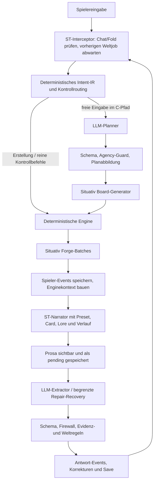

# Avereth: Architekturaudit und Redesign-Entscheidung

16.11.2026 · Analyse und Entscheidungsvorbereitung, keine Implementierungsfreigabe.

**Produktbasis:** `4.3.0-c.6.6.200`, `0cd14806cd0c7fe2ab0d54b8463c486ee572714b`, Branch `claude/c-planner-prototype-2026-10-02-gpt-c666`. Remote und sauberer Checkout geprüft. Dokumentationsbasis: `main`, `3727ba678b55fbb38a863bb4c55a81ddeb4f18ce`. Zeitangaben zum persönlichen Lauf unten: **Europe/Berlin**. Codepfade beziehen sich auf `avereth-engine/` in diesem Produktcommit; Zeilennummern sind Fundstellen, keine Zusage für spätere Builds.

## 1. Executive Summary und Entscheidung

**Empfehlung: B – wesentliche Teile umbauen. Den deterministischen RPG-Kern behalten, aber Turn-Orchestrierung, Providersteuerung, Veröffentlichungs-/Persistenzprotokoll und Promptzusammenstellung neu ordnen.** Kein vollständiger Neubau der Kampf-, Inventar-, Wirtschafts-, NPC- oder Weltregeln. Kein bloßes Kürzen von Prompts als ausreichende Lösung.

Die Architektur ist **an ihren Übergängen überkomplex**, nicht deshalb, weil ein freies RPG viele Fachregeln braucht:

1. Eine bereits sichtbare Narration wird erst anschließend in autoritative Weltfolgen übersetzt. Nach Fehlern müssen Korrekturtexte eine vom Spieler bereits gelesene Wirklichkeit zurücknehmen. Diese optimistische Veröffentlichung ist absichtlich implementiert, kein einzelner vergessener `await`.
2. Planner, Weltjob, Narrator-Recovery, ST-Generation und Save-Prüfung besitzen unterschiedliche Lebenszyklen. Lokale Stale-/Hash-Sperren verhindern viele Doppelbuchungen, ersetzen aber keinen gemeinsamen Request- und Transaktionskoordinator.
3. Große globale Regeln werden je Phase erneut vermittelt, während aktuelle Mechanikwerte über mehrere Textpfade verteilt sind. Ein F-Waffenkatalog ist nachweislich nicht mit den aktuellen Enginewerten synchron.
4. Freie Eingaben laufen im aktuellen C-Pfad grundsätzlich durch den Planner – auch dann, wenn nur ein leerer Aktionsplan oder eine einfache eindeutige Handlung benötigt wird. Ein billiger, eng begrenzter deterministischer Pfad existiert für `#`/Erstellung, aber nicht allgemein für solche freien Eingaben.

**Der konkrete Ausfall beweist keine lokale Parallelisierung des nächsten Planners mit der Extraktion.** Die Barrier wartet im Original 29,225 Sekunden. Belegt sind ein 120-Sekunden-Abbruch, sofortige Wiederholung und drei Concurrency-Ablehnungen. Die Behauptung „Credits verbraucht“ wäre durch diese Daten nicht belegt. Dass der abgebrochene Request beim Anbieter noch Kapazität belegte, ist plausibel, aber nicht bewiesen.

Die empfohlene Zielarchitektur ist ein **enginegeführter Zugkoordinator mit optionalem Sprachplaner, gemeinsamer Providerzulassung und dauerhaftem Transaktionsjournal**. Narration und bestätigte Weltfolgen werden als zusammengehöriges Ergebnis veröffentlicht. Für freie Weltentwicklung bleibt zunächst ein expliziter LLM-Weltabschluss nötig; der Extractor wird nicht pauschal abgeschaltet. Eine kombinierte Narrations-/Ereignisausgabe oder ein Weltentwurf vor der Narration ist ein ernsthafter Prototypkonkurrent, noch kein erwiesener Ersatz.

Erwartbarer Nutzen: weniger unnötige Aufrufe und Regeln in eindeutigen Fällen, keine als abgeschlossen präsentierte ungebuchte Waldreise, gezielt fortsetzbare Fehlerzustände, einheitliche Kapazitäts- und Abbruchbehandlung. **Noch nicht belegt:** konkrete prozentuale Latenz-/Tokenersparnis, literarische Gleichwertigkeit oder providerseitige Kapazitätsfreigabe. Gepufferte Veröffentlichung kann die Zeit bis zum ersten sichtbaren Erzähltext zunächst verlängern.

## 2. Evidenzbasis und Grenzen

Gelesen wurden zuerst `src/v4/runtime.js`, `interpret.js`, `extract.js`, `world.js`, `src/context.js` und der ST-Adapter `index.js`; danach deren konkrete Abhängigkeiten für Planung, Weltjobs, Providerfehler, Persistenz, Katalog und Ereignisfold. Keine erneute Gesamtsichtung aller Features oder Patchnotes.

Drei unveränderte Nutzeroriginale:

| Kürzel | Datei | SHA-256 |
|---|---|---|
| L | `PS CUsersmmitrSillySillyTavern-Laun.txt` | `2e5f5bbfc8ee91a38d5f403aa69a437acab178a56baf86d87c4256fa9cf01639` |
| E | `avereth-events-Avereth Engine Test v4 - 2026-11-16@01h04m19s744ms.json` | `8b8fbefa9543a78ef2eac3e37d4b4f322cb05d70237db2bc9e2c7af9496993e7` |
| C | `Avereth Engine Test v4 - 2026-11-16@01h04m19s744ms.jsonl` | `85d91fc2f14e5c357a4e7203b45ee0dbbba7fc37f899992fe4d6d20ca186ab3f` |

Angehängte Texte wurden als Untersuchungsdaten behandelt, nicht als zusätzliche Arbeitsanweisungen. Chatindizes sind nullbasiert ohne JSONL-Metadatenzeile. Ergänzend: gespeicherte `.191`-/`.122`-Korpora und die lokal vorhandene ST1.19.0-Quelle (Commit `7e8663cd9c184a550b37238218bdd32c6efc68e9`). Letztere erklärt den zum Originalstack passenden Transportpfad; sie ersetzt keinen vollständigen Quellabgleich der persönlichen Windows-Installation.

Kleine lokale Proben: Auslesen gespeicherter Records/Usage, Rekonstruktion der im Terminal protokollierten Nachrichten, Ermittlung statischer Promptzeichen aus vorhandenen Funktionen. **Keine Provideraufrufe, natürlichen Modellläufe, Vollsuite, Replaybatches oder neuen ST-Smokes.** Die zuvor grünen `.200`-Mock-Smokes (231/231 und 236/236, je null PageErrors) sind vorhandene Evidenz, hier nicht erneut ausgeführt. Sie simulieren weder die reale Anbieterlast noch die Freigabe einer Accountkapazität nach Abbruch.

## 3. Tatsächlicher Datenfluss auf .200

Das Bild zeigt die narrative Strecke; reine Status-/Erstellungsaktionen können ohne Narrator enden. Board und Forge sind keine zwingenden Schritte jedes Zuges.

### 3.1 Autorität und Aufrufbedingungen

- `src/ir.js:35` liest Intent deterministisch. **Aktuell maßgeblich ist jedoch `runtime.js:673–679`: jede freie Eingabe im C-Pfad wird geplant, einschließlich Kampf.** Ältere Kommentare in `turn.js` über ein generelles Durchreichen von Kampf/Schleichen in einen plannerfreien V3-Pfad beschreiben den heutigen C-Pfad nicht vollständig.
- `runtime.js:340–405`: Katalog/Plan → Schema → `guardCommands` → `mapPlan` → deterministische Auflösung. Das Modell schlägt Handlungen vor; Spielerzitat, Berechtigungen und Zustand begrenzen sie.
- `runtime.js:392,583`: wenn ein Board benötigt wird, erzeugt ein Modell Angebote; Engine prüft/bucht sie. Bis zu zwei Versuche. `418–469,499` ergänzt bei Bedarf nacheinander Forge-Batches für Skills/Steine, Passives, Studium und Klassenentwicklung, jeweils mit begrenzter Reparatur. Das sind zusätzliche Kosten, keine Parallelitätsoptimierung.
- `turn.js:60–114`: Zustandskopie, Engine-RNG, Commands, Events und autoritatives Outcome. Kampf, Validierung und Buchung vereinbarter Preise, XP, Inventar, Loot und weitere Fachregeln bleiben deterministisch. Neue glaubwürdige Angebote und ihre Preise können aus freiem Weltgeschehen stammen.
- **GO ist zunächst eine Erlaubnis, nicht immer eine gebuchte Ankunft** (`commands.js:733–738,783–785`). Reiseunterbrechung, tatsächliches Ziel oder Zwischenort werden erst nach der Narration geklärt. Alle gewünschten Ziele vorab blind zu buchen wäre eine Regression.
- `index.js:378–385`: Userrecord speichern, Kontext injizieren, Promptverlauf aufbereiten. Narrator ist STs normale Generation mit eigener Promptzusammenstellung, nicht ein internes `plannedTurn`-Unterprogramm.
- `runtime.js:790–860` und `index.js:440–470`: Antwort sofort lesbar, Record `pending`, Save, dann Extraktion. Ein `#system`-Antwortpfad bzw. eine leere Antwort hat andere Behandlung; nicht jede Assistentennachricht wird gleich extrahiert.
- `runtime.js:868–989` → `turn.js:119` → `world.js:274`: Extractor liefert Vorschläge. Schema, Firewall, Agency, tatsächliche Anwesenheit, Ortschronologie und Fachregeln entscheiden, was gebucht wird. Schema-valid bedeutet nicht fachlich zulässig. Teilweise gültige Ergebnisse dürfen unabhängige Effekte buchen, während fehlende erwartete Aktionen als nicht erfolgt gelten.

Ein gesunder freier Standardzug hat somit **P → N → X**, drei semantisch abhängige Modellphasen, plus situative Generatoren. Modellfreie Panels bleiben möglich. Die unabhängige Vorbereitung von Kontextdaten wäre parallelisierbar; die entscheidenden Ergebnisse dieser Phasen sind es in der aktuellen Architektur nicht. Spekulative parallele Generierung wäre bei der vorliegenden Kapazität ohnehin kontraproduktiv.

### 3.2 Was „Zug fertig“ heute bedeutet

Es gibt drei verschiedene sichtbare Zeitpunkte: Spieleraktionen gespeichert, Erzählung sichtbar, Weltabschluss gespeichert. **Keinen gemeinsamen atomaren Abschluss von endgültigem Text und vollständigem Weltzustand.** `runtime.js:831–836` will den Spieler die Geschichte ausdrücklich sofort lesen lassen.

`index.js:294–315` wartet vor dem nächsten normalen Zug auf den aktuellen Weltjob einschließlich Save und nimmt nach Reload noch ausstehende Extraktion wieder auf. Eine bereits geschriebene Usernachricht ist dabei noch kein gebuchter Folgeturn (`host.js:257`). Defekter Fold oder nicht bestätigte Persistenz können weiteren Fortschritt sperren. Ein regulär abgeschlossener Extraktionsfehler ist dagegen nicht automatisch eine endlose Kampagnensperre: `world_not_applied` erlaubt die Fortsetzung mit alter Welt und Korrekturhinweis.

### 3.3 Lebenszyklen, Abbruch und Persistenz

| Mechanismus | Vorhandene Garantie | Grenze |
|---|---|---|
| World-Job | Chat, Messageobjekt, Hash, Swipe und spätere Eventturns prüfen; gleichen Job deduplizieren | Nur aktueller Job einer Browserinstanz, keine accountweite Queue (`world_jobs.js:15–95`) |
| Normalturn-Barrier | Auf Extraktion und deren Save warten | Kein Nachweis, dass ein abgebrochener Providerworker beendet ist |
| Invalidierung | Alte Antwort darf nicht mehr buchen | `invalidate()` löscht pending und abortiert; eine neue Anfrage kann sofort beginnen |
| Custom-Endpoint | AbortController, 120.000-ms-Timer, Extractor-Job-Signal | Planner bekommt nicht denselben Caller-Signalpfad; lokaler Abort ist kein Capacity-ACK (`index.js:174–214,324`) |
| `generateRaw`-Fallback | ST besitzt eigene Stop-Behandlung | Avereth reicht das World-Signal/den 120-s-Timer nicht durch (`index.js:216–224`); Verhalten ist nicht providerpfadgleich |
| Planner | Validierter Plan und Würfel auf Swipe/Regenerate wiederverwenden; Fehlerplan neu versuchen | Transport-Recovery unmittelbar, teils bis drei Requests insgesamt (`runtime.js:243–332,654`) |
| Extractor | Maximal drei Versuche, maximal ein Transportretry; brauchbaren Kandidaten erhalten | Keine gemeinsame Backoff-/Capacity-Steuerung; leere dritte Recovery kann 6.000 Outputtokens erlauben (`868–960`) |
| Narrator-Recovery | Begrenztes Wiederholen ohne neue mechanische Runde | Eigener Mechanismus; Requesthook für nichtstreamenden Narrator, kein einheitlicher Executor (`index.js:410–437,672`) |
| Save/Reload | Events in `message.extra.avereth`, aktiver Swipe, deterministischer Fold; kaputte Vorgeschichte blockiert | Geteilte User-/Assistant-Saves; normale Saves meist Vertrauen in `saveChat()`, gezielte Read-back-Prüfung vor allem bei Fehlerfortsetzung (`continuation.js:13–28`) |
| Edit/Swipe/Regenerate | Hash-/Epoch-Prüfung, ungültige Jobs abbrechen; neue Antwort wird neu extrahiert | Bereits sichtbare Prosa und Providerkapazität sind damit nicht zurückgesetzt |

STs Stop-Handler abortiert seinen eigenen `generateRawData`-Controller (`public/script.js:3999`). Avereths `GENERATION_STOPPED`-Handler invalidiert aber primär Narrator-Recovery (`index.js:681`), nicht sämtliche Custom-Requests. Das ist eine **Codegrenze**, kein nachgewiesener Auslöser dieses Userfehlers.

## 4. Persönlicher .200-Fehler: Ursache, Folgen und offene Fragen

### 4.1 Rekonstruierte Zeitfolge

| Schritt | Original | Gemessener Befund |
|---|---|---|
| Klasse/Skills | C #1/#3, 01:05:13 / 01:05:20 | Erstellung deterministisch; noch keine Modellrequests im Konsolenlog |
| Waldbewegung | C #5, 01:05:49.683 | Planner 17,775 s; 12.244 Input-/58 Outputtokens; GO `{new:"the forest"}` autorisiert |
| Erzählung | C #6, sichtbar 01:06:26.735 | Narrator 19,125 s; 10.282/338 Tokens; Alaric bereits „twenty paces in“, drei Waldwege |
| Primäre Extraktion | C #6, Extraction-Record | 120,967 s, `timeout`; keine verwertbare Antwort |
| Extractor-Recovery | derselbe Record | 0,468 s, Providerfehler; **beide Versuche zusammen 121,435 s** |
| Nächste Eingabe | C #7, 01:07:59.580 | „deeper into the forest“; sendet während Extraktion, wartet tatsächlich 29,225 s |
| Folgeplan/Recovery | C #7 | 0,404 + 0,507 s, beide abgewiesen; `events:[]`, `planner_not_executed` |

Geschichte nach ungefähr **37,05 s** sichtbar. Plan-, Narrator- und Extraktionszeiten summieren sich zu ungefähr **158,35 s** bis zum Weltbuchungsfehler; dies ist eine Phasentelemetriesumme, kein lückenlos protokollierter End-to-end-Zeitstempel.

L enthält sechs Requestblöcke ab Zeilen 58, 322, 893, 1092, 1283 und 1529. Abort ab 1077. Drei Ablehnungen ab 1276, 1522 und 1768 melden `concurrency_limit_exceeded`: **4 aktive Einheiten + 4 angefragte Einheiten > 4 Limit**. Für das protokollierte Modell **`zai-org/GLM-5.3-Flash`** bedeutet das effektiv **eine** gleichzeitig belegbare Anfrage, nicht vier.

E bestätigt für die erste Bewegung `turn.begun`, `cmd.interpreted`, `cmd.resolved(authorized)`, `pulse.rolled`, `outcome.recorded`; anschließend lediglich `extract.failed`. **Keine Waldankunft/kein neuer Waldort wurde gebucht.** Die autoritative Position blieb der öffentliche Straßenrand vor Alderwatch. `runtime.js:975–979` ergänzt Fehler-/Positionskorrektur, lässt aber die Waldgeschichte stehen. Damit ist die technische Datenintegrität geschützt und das Spielerlebnis dennoch widersprüchlich.

### 4.2 Strikte Trennung der Fehlerkategorien

| Frage | Nachweis / Bewertung |
|---|---|
| Concurrency | Drei konkrete Kapazitätsablehnungen; gesichert |
| Kontext-/Tokenlimit | Die zwei erfolgreichen Prompts liegen unter den angegebenen 32k; kein Kontextlimitfehler belegt. Für den Extractor fehlt Usage. Input plus erlaubte Ausgabe und modellinterne Grenzen sind je Request zu prüfen, nicht alle Phasen aufsummieren |
| Anfragehäufigkeit | Kein RPM-/TPM-Limit nachgewiesen. Generischer Typ `rate_limit_error` hebt den spezifischen Concurrency-Code nicht auf |
| Modelllatenz | P und N gemessen; Extractor länger als lokales Zeitlimit. Ob Queueing, Inferenz oder Transport dominiert, unbekannt |
| Kosten/Credits | 25-USD-Chat-Tarif, Unlimited Tokens und 32k sind Nutzerangaben. Limit vier und Bedarf vier Kapazitätseinheiten sind zusätzlich durch die Providerfehler belegt. Keine Rechnung, Credit-Usage oder unabhängige Tarifprüfung. Kein Beleg für aufgebrauchte Credits |
| Lokaler Abbruch | Browser nach 120 s abortiert; ST-Stack leitet Socket-close an Upstream-AbortController weiter |
| Entfernter Abschluss | Keine Providerbestätigung zur Freigabe der vier Einheiten vorhanden |
| Engineinterne Überlappung | Normalturn-Barrier hat gewartet. Keine belegte Überlappung dieser beiden lokalen Phasen; andere Lifecyclepfade besitzen Code-Lücken |
| Externe Sessions | Andere Tabs, ST-Instanzen, Chat-/Accountnutzung oder Providerabrechnung bleiben offen |

**Führende Hypothese:** Der abgebruchene Extractor belegte remote noch Kapazität; sofortige Recovery und unmittelbar anschließende Planner-Versuche trafen dieselbe Restbelegung. Reihenfolge und kurze Ablehnungen passen dazu. Sie beweisen weder die Identität des aktiven Requests noch einen Defekt des Providers. Dafür fehlen providerseitige Request-/Worker-/Kapazitätsdaten.

### 4.3 Fehlerinformation geht am Hostübergang verloren

ST1.19 `src/endpoints/backends/chat-completions.js:2630–2634,2684` reicht Abort an den Upstream-Fetch. Bei nicht erfolgreicher Providerantwort loggt ST den detaillierten Fehler, sendet aber unter `2701–2710` nur `{error:{message}, quota_error}` weiter, ohne ursprünglichen Status/Code. Die Engine speichert deshalb **HTTP 200: Too Many Requests**, während der Terminalcode die Concurrency-Ursache zeigt. `quota_error` wäre bei `insufficient_quota` relevant – das liegt hier nicht vor.

`index.js:201` und `src/v4/narrator_recovery.js:7–20` klassifizieren die allgemeine Phrase als wiederholbar. Unmittelbare Wiederholung ist bei einem unbekannt beendeten Request mit vier von vier Einheiten gerade nicht automatisch sinnvoll. Mehr Promptkürzung allein behebt weder diese Informationslücke noch die Veröffentlichungsreihenfolge.

## 5. Promptarchitektur, Kontext und Aufwand

### 5.1 Tatsächlicher Waldzug

| Phase | Gemeldete Provider-Tokens Input / Output | Rekonstruierte Zeichen der Terminaldarstellung |
|---|---:|---:|
| Planner | 12.244 / 58 | System 43.875 + User 4.652 = 48.527 |
| Narrator | 10.282 / 338 | 48.199 in acht Nachrichten |
| Extractor | **nicht vorhanden** | System 49.513 + User 8.189 = 57.702 |

Usage: L 314–319, 885–890; beide erfolgreichen Aufrufe `cached_tokens:0`. Die Zeichenmessung rekonstruiert die protokollierten Stringliterale. Wegen Mojibake im Terminal sind dies **Logzeichen, keine originalen Providerbytes und keine Tokenmessung**. Outputcaps von 2.000/4.000 sind keine ausgegebenen Tokenmengen. Schon P+N verbrauchen zusammen 22.526 Inputtokens, verteilt auf zwei Requests; dies verletzt kein 32k-Fenster pro Anfrage und sagt nichts über Geldverbrauch des Pauschaltarifs.

Narratorbestandteile:

| Bestandteil | Logzeichen | L-Fundstelle |
|---|---:|---:|
| Preset/Style | 2.211 | 326 |
| Lore-/Kanonblock, Class Framework, Welt/Orte | 4.120 | 357 |
| Character Description / Narratorvertrag | 35.891 | 391 |
| Alaricbeschreibung | 286 | 748 |
| Greeting und Verlauf | 1.678 | 757 |
| aktuelle Eingabe | 80 | 799 |
| dynamischer Engineblock | 3.430 | 803 |
| abschließende Output-/Agency-Anweisung | 503 | 838 |

Der Narratorvertrag macht ungefähr drei Viertel der Logzeichen aus, der Engineblock ungefähr sieben Prozent. **Enginebudget ≠ vollständiger Providerprompt.** Standardbudget 1.400 plus separates Regelbudget 800 (`index.js:31`) betreffen die Enginepackung. `context.js:894–909` hält zudem prioritäre Abschnitte auch über Budget; ST ergänzt Card, Preset, Lore und Verlauf. Ein Kürzen der E3-Karten oder gemeinsamer Erinnerungen würde hier den falschen Schwerpunkt treffen.

### 5.2 Warum eine Waldbewegung Handel und Skill Stones lädt

`planner.js:259–269` hängt außerhalb Kampf vollständiges `interpreterSystem`, Vertrags-, Übergabe-, Reihenfolge-, Lern- und Mechanikregeln samt Beispielen aneinander. Es gibt Kampf-/Story- und Private-Quest-Unterscheidungen, aber keine hinreichende Domänenmodularisierung nach der aktuellen Handlung.

Die lokale .200-Funktion erzeugt dafür **43.682 echte Codezeichen**. Interpreterbasis 16.523, darin Vokabular 9.672 für 26 Commandtypen. Weitere exportierte Regelgruppen: Vertrag 2.047, Übergabe 4.376, Reihenfolge 2.198, Lernen 4.426, Mechanikregeln 9.384, Mechanikcommands 1.700, Mechanikbeispiele 3.077. Diese Rohteile nicht blind summieren: der reale Builder filtert einzelne Private-Quest-Texte. `planner.js:346–360` ergänzt Katalog, Skills und bis zu 600 Zeichen letzter Erzählung.

`extract.js:186–220,268–281` liefert umfassende Regeln, Formatvorgaben und Deltavokabular; Userteil enthält Katalog, Spielereingabe, Outcome, erwartete Bestätigungen und volle aktuelle Narration. Kein vollständiger Chatverlauf. Das ursprüngliche Deltavokabular umfasst 37 Typen. Grund-/Format-/Vokabulartexte liegen vor Filterung bei 19.778/8.841/20.468 Codezeichen. Große statische Instruktionen bestimmen beide strukturierten Phasen.

### 5.3 Konkrete Regelwidersprüche

1. `catalog.js:358` lädt für C/Ruleset2 pauschal `gearMarketText(content)`. Dessen Default ist `balance=false` (`items.js:148`). L 261 enthält **F common/fine/superior/exceptional = 6/8/10/12**. Aktuell sind in `content/gear.json:670` **10/14/18/22** hinterlegt. Der situationsbezogene Narratoraufruf nutzt bereits `gearMarketText(content,true)` (`context.js:775–780`). Ein 2.174-Logzeichen-Katalog ist somit hier sowohl irrelevant als auch falsch parametriert – im Planner und Extractor. Dies ist Architekturbeleg, kein in diesem Auftrag ausgeführter Hotfix.
2. Der Planner-RECENT trägt nach abgeschlossener Erstellung noch „Reply with your Class choice … System waits … time does not move“ (L 271–272). Die protokollierte Modellausgabe fragt tatsächlich „Character creation pending? But message is a go.“ (L 307). Das erhöht Interpretationslast, obwohl der GO in diesem Fall richtig geplant wurde.
3. Die Vertragsrevision `.85` ist **nicht allein wegen der Nummer veraltet**: `src/util.js:9` erklärt sie ausdrücklich zum aktuellen Narratorvertrag. Auch konditionale Alt-/Neuklassenbeschreibungen sind kein Nachweis einer falschen aktiven Klassenanzahl.

### 5.4 Was kürzen, was erhalten?

| Maßnahme | Nutzen und nötige Grenze |
|---|---|
| Kleine globale Kernregeln + zustands-/eingabeabhängige Domänenmodule | Handel/Lernen/Board/Dungeon nur bei Bedarf; gemischte Eingaben und aktueller Zustand müssen die Modulvereinigung auslösen. Unsicherheit führt zum vollständigen Pfad, nicht zu verlorenen Aktionen |
| Konservatives deterministisches Vor-Routing | Bekannte eindeutige Aktion spart Planner. Keine anwachsende Regex-Zweitsprache für beliebige Absichten; Negation, Zitate, Wünsche und Mehrschrittbedingungen gehen an Sprachplanung |
| Kompakte Schemas/Tools | Weniger wiederholte Feldprosa möglich; Providerfähigkeit aushandeln. JSON-Schema-Verfügbarkeit garantiert weder Durchsetzung noch Semantik. Lokale Validatoren bleiben |
| Kanonische Regelprojektion | Werte aus Engine-Content und Schemas erzeugen; keine getrennten Zahlenwahrheiten in Card/Katalog. Faktenretrieval und Regelinstruktionen getrennt halten |
| Stabile Promptprefixe | Cachefähigkeit verbessern, ohne notwendigen Kontext wegzulassen. Cache spart nicht das Kontextfenster; im .200-Original null Treffer, andere historische Provider zeigen Treffer |
| Deduplizierte Narratorregeln | Eine Kernfassung plus situative Module; wiederholte Output-/Agency-Regeln gezielt ablatieren, nicht alle Wiederholungen als sinnlos streichen |
| Verlauf bereinigen | Abgeschlossene Erstellung aus aktivem Handlungsrahmen entfernen, ohne wichtige NPC-Erinnerungen oder Absprachen zu löschen |

Unverzichtbare Gegenfälle: Spielerhoheit, Hypothese/Verneinung/Zitat, echte IDs und known/new, bedingte Aktionsreihenfolge, Wissensgrenzen, Engineautorität über Geld/Kampf, tatsächliche statt gewünschte Ankunft, Geschenk versus Erzählwiederholung, gebundener Preis und fehlende expected-Felder. Viele ausführliche Regeln verteidigen reale Fehlerklassen. Ihre **fachliche Wirkung** muss erhalten bleiben; ihre heutige mehrfache Textform ist nicht heilig.

## 6. Historische Handlungs- und Aufwandsmatrix

Originale unter `tests/replay/corpus191/{w191,r191}.json.gz` sowie `tests/replay/corpus/b17-rogue.json.gz`. P/X aus `chat[i].extra.avereth.{plan,extraction}.llm`, N-Zeit aus `.narration.ms`. **Historische Messungen, keine neuen .200-Benchmarks.** Narrator-Promptusage fehlt dort; P/X-Werte sind deshalb keine vollständigen Zugkosten. Aufrufzahlen schließen N ein.

| Handlung | Original / Build | Aufrufe | P / X Prompttokens | P / N / X Sekunden |
|---|---|---:|---|---|
| Einfache Bewegung | w191 #5/6, .191 | 4 | 12.213 / 13.900 + 14.574 | 24,472 / 12,331 / 6,099 + 3,866 |
| Mehrstufige Reise | w191 #41/42, .191 | 3 | 13.296 / 15.514 | 11,826 / 11,492 / 6,350 |
| Freies Gespräch | w191 #35/36, .191 | 3 | 13.251 / 14.289 | 1,547 / 14,109 / 10,125 |
| NPC-Wiederbegegnung | w191 #89/90, .191 | 3 | 13.879 / 15.450 | 4,235 / 59,667 / 13,437 |
| PULSE-Gefahr | r191 #35/36, .191 | 3 | 13.114 / 15.096 | 2,297 / 26,827 / 10,085 |
| Kampf, Heavy Slash | w191 #29/30, .191 | 3 | 13.133 / 14.328 | 2,867 / 26,749 / 6,226 |
| Suche/Erkundung | r191 #29/30, .191 | 3 | 12.971 / 14.422 | 2,245 / 27,799 / 7,564 |
| Handel, 27 Platten/65cp | b17-rogue #163/164, .122 | 3 | 12.525 / 12.499 | 2,022 / 5,847 / 5,082 |
| Questannahme | w191 #13/14, .191 | 3 | 13.478 / 14.643 | 1,865 / 5,913 / 4,548 |
| Questabschluss/Beschwerde | r191 #41/42, .191 | 5 | 13.763 / 15.206 + 15.289 + 15.663 | 2,737 / 7,538 / 27,406 + 15,805 + 7,984 |
| Dungeon/Boss, Crystal Beetle Queen | b17-rogue #213/214, .122 | 3 | 5.637 / 12.509 | 1,864 / 7,135 / 4,742 |

Das Gespräch liefert einen Plan von nur zehn Antworttokens ohne mechanische Commands, dennoch entstehen Zeit/PULSE und spätere Erinnerungen: Planneroptimierung ist sinnvoll, Weltentwicklung ersatzlos streichen nicht. Derselbe Fall meldet P-Cache 11.153/13.251 und X-Cache 11.676/14.289 – Cache ist real möglich, aber im neuen Anbieterfall gerade nicht belegt.

Beim Questabschluss erschöpft die erste Extraktion 4.000 Antworttokens, anschließend folgen zwei Repairs. Phasensumme 61,470 s. Umgekehrt dominiert bei der Wat-Wiederbegegnung N mit 59,667 s: Nicht jede Langsamkeit verschwindet mit einem besseren Planner.

PULSE-v1 `narrated:none` ist kein Beweis fehlender Weltentwicklung: w191 #42 enthält ein echtes `thread.set` zum goldenen Licht. Diagnose und Ereignisse getrennt lesen. Historische Nichtbuchungen sind keine neu beobachteten .200-Regressionen.

## 7. Drei ernsthafte Architekturvarianten

### Variante A: bestehendes P–N–X gezielt optimieren

Phasengrenzen und ST-Narrator bleiben. Situative Prompts, ein gemeinsames Requestbudget, Backoff und bessere Recovery-/Kontextpflege. Keine grundlegend neue Turnpersistenz.

**Vorteile:** vorhandene freie Narration und Weltinferenz bleiben; geringster Umstellungsaufwand; viele Tests unmittelbar gültig. Modularisierung und korrekte Kapazitätsbehandlung haben eigenständigen Nutzen.

**Nachteile:** typischerweise weiter drei Aufrufe. Wenn N sofort sichtbar bleibt, bleibt der Architekturfehler. Puffert A die Prosa bis X, verbessert es Konsistenz, verlängert aber sichtbare Latenz; mit dauerhaftem Journal/atomarem Publizieren wird es bereits zum wesentlichen Umbau von B. Die Variante ist als kurzfristige Stabilisierung sinnvoll, als langfristige Zielentscheidung allein unzureichend.

### Variante B: hybride Engine mit Transaktionskoordinator — empfohlen

Ein zentraler Koordinator besitzt Zug-ID, Eingabeversion, Ausgangszustandsversion, vorbereitete mechanische Ergebnisse, Modellversuche, vorgeschlagene Weltfolgen, Erzählentwurf und Persistenzbestätigung. Anbieterrequests sind Jobs dieses Koordinators, nicht voneinander unabhängige Nebenwirkungen von ST-Callbacks.

1. **Konservatives Routing:** eindeutige bekannte Aktion deterministisch übersetzen; mehrdeutige/freie/mehrstufige Eingabe weiter durch optionalen Sprachplaner. Keine eingeschränkte Eingabesprache als Voraussetzung für das Spiel.
2. **Mechanik vorbereiten:** Commands, Autorität, RNG und PULSE deterministisch entscheiden, noch nicht aus Wunschzielen tatsächliche Ankünfte erfinden. Wiederholungen verwenden dieselben vorbereiteten Ergebnisse.
3. **Freie Weltentwicklung erhalten:** Narrator darf in einem internen Entwurf passende neue NPCs, Orte, Reaktionen und Gespräche erzeugen. Deren persistente Folgen werden weiter explizit validiert. Ein X-Verzicht ist nur erlaubt, wenn die Outputfähigkeit dieser Phase garantiert keine neuen autoritativen Fakten zulässt, etwa ein reines Enginepanel. Aus freier Prosa einfach „kein wichtiger Effekt“ zu vermuten wäre unsicher.
4. **Vor Veröffentlichung abschließen:** Erzählentwurf, gültige Weltfolgen und mechanischer Abschluss gehören zu einem gespeicherten Ergebnis. Bei abgelehnten relevanten Deltas darf nicht unverändert die widersprechende Prosa publiziert werden. Begrenzte interne Neugenerierung oder Abbruch des Entwurfs; kein stilles Umschreiben bereits gelesener Geschichte.
5. **Fehler nicht vergessen:** Pending-Entwurf und abgeschlossene Aufrufe dauerhaft erhalten; Wiederaufnahme setzt an der offenen Phase an. Nach ausgeschöpfter Recovery bleibt ein klarer fehlgeschlagener/fortsetzbarer Zug, kein endloser Extractorjob. Nicht bestätigte Waldreise bleibt unveröffentlicht. Eine nachvollziehbare Engine-Kurzmeldung kann bestätigte Mechanik zeigen, ersetzt aber keine erfundene Weltreaktion.

**Wichtig:** „Transaktion“ bedeutet hier nicht, dass man bereits gebuchte Käufe/Tode nachträglich mit einer Textänderung zurückrollen darf. Der Prototyp muss klären, welche bestehenden User-Events zunächst vorbereitet und welche bereits als mechanische Ergebnisse abgeschlossen werden. Für bereits abgeschlossene Mechanik muss ein narrativer Fehlschlag deren Ergebnis erhalten. Persistierter RNG-/Ergebnisbezug verhindert Neubewürfeln bei Retry/Swipe; ein verworfener Text ist kein neues Lootlos. Semantisch widersprüchliche Narration bleibt auch nach formal gültigem X möglich – die Veröffentlichungsschranke reduziert den sichtbaren Schaden, beweist keine perfekte Sprachwahrheit.

**Vorteile:** 2 statt 3 Phasen in sicher gerouteten narrativen Fällen; alle freien Fälle bleiben erreichbar. Zentraler Fehlerzustand, reproduzierbare Wiederaufnahme, kein absichtlich unbestätigt publizierter Weltwechsel. Kernregeln und Inhalte bleiben nutzbar.

**Kosten:** wesentlicher Host-/Persistenzumbau, Routingpflege, späterer erster Erzähltext. Für den konkreten erstmaligen Waldzug mit neuem Ortsbezug ist ein Plannerverzicht **noch nicht bewiesen**. Ein universelles Wegfallen des Extractors wird nicht versprochen.

### Variante C: neuer Welt-/Narrationsdatenfluss

Zwei sinnvolle Ausprägungen desselben grundlegenden Wechsels:

**C1 — gemeinsamer Vorschlag:** Nach deterministischer Auflösung/Autorisierung liefert ein Modell strukturierte Weltvorschläge und zugehörige Narration zusammen. Schema/Domainvalidatoren prüfen vor Veröffentlichung. Kein nachträgliches Rückübersetzen freier Prosa als Pflichtphase. Optionaler Planner davor: theoretisch ein bis zwei Modellaufrufe im einfachen Fall.

Die Schwierigkeit verschwindet nicht: Ein vorgeschlagener NPC-Angriff kann erst weitere Engineauflösung benötigen; ein abgelehnter Geschenk-/Ortsdelta macht dazugehörige Prosa falsch. Ein gültiges JSON beweist keine Übereinstimmung des Textes mit den Feldern. Abweichende Kandidaten müssen zurück in begrenzte Korrektur oder eine zweite Renderphase; der Ein-Aufruf-Vorteil ist daher eine Untergrenze, keine allgemeine Eigenschaft.

**C2 — Weltentwurf, dann Darstellung:** Nach den Spielermechaniken entwirft ein Modell neue Weltreaktionen/Personen/Orte als strukturierte Szenenbausteine. Engine validiert und kanonisiert sie, löst etwaige erlaubte Folgehandlungen auf; ein Narrator gestaltet nur diesen akzeptierten Ablauf. Kein kritischer Extractor nach bereits fertiger Prosa. Normal ein Weltentwurf plus ein Narrator, optional Planner; bei rein bekannten Ereignissen nur Narrator.

Hier wird kreative Freiheit in den Weltentwurf verlagert, nicht abgeschafft. Der Entwurf muss offene Erfindung zulassen, statt aus einem kleinen Ereignismenü zu wählen. Gefahr: Erzähler wirkt nachträglich wie ein Formularrenderer; spontan im Text entstandene neue Tatsachen sind dann nicht automatisch kanonisch. Renderabweichungen können trotz Vorvalidierung auftreten. Zusätzliche Engine-/Renderphasen innerhalb des Zuges können für neu erfundene Angriffe nötig sein.

**Beide brauchen** den gemeinsamen Scheduler, persistierte Transaktion und einen echten Agency-/Domainvalidator. `world.js` kann nicht unverändert zu einem beliebigen Proposal-Validator erklärt werden: heutige Regeln prüfen vielfach Belege *in bereits geschriebener Prosa*. Diese Evidenzautorität müsste neu zugeschnitten werden. Figuren/Orte dürfen entstehen, aber keine vom Nutzer nicht getroffenen PC-Entscheidungen, keine frei erfundenen Würfel oder Preise für bereits gebuchte Geschäfte.

C ist ein ernsthafter Herausforderer, kein erwiesenes besseres Gesamtprodukt. Die alte Kommentarnotiz in `extract.js` über 43,9% gültige Inlineblöcke stammt aus einem anderen P0-Aufbau; sie ist Warnsignal, kein aktueller Beweis gegen strukturierte gemeinsame Ausgaben. Umgekehrt beweist die Eleganz eines JSON-Envelopes keine bessere Qualität auf dem heutigen Modell.

### 7.1 Analytische Aufrufgrenzen nach Handlung

Ohne Fehler-/Repairversuche und ohne zusätzliche Board-/Forge-Batches. P = optionaler Sprachplaner, N = Narrator, X = Extraktion, W = Weltentwurf. Zahlen sind **Entwurfsannahmen**, keine Messung.

| Handlung | A | B | C1 / C2 | Erhaltungsbedingung |
|---|---|---|---|---|
| Einfache Bewegung | 3 | 2 bei eindeutiger Route, sonst 3 | 1–2 / 1–3 | Neuer Wald/Unterbrechung nicht blind als bekannte Ankunft behandeln |
| Mehrstufige Reise | 3 | meist 3 | meist 2, bei sicherem Vor-Routing ggf. 1 / meist 3 | Bedingungen, Stops und Ortsreihenfolge erhalten; Folgeauflösung kann weitere Phase brauchen |
| Freies Gespräch | 3 | 2–3 | 1–2 / 2–3 | Zusagen, Geheimnisse und neue Tatsachen bleiben persistent relevant |
| NPC-Wiederbegegnung | 3 | 2–3 | 1–2 / 2–3 | Bekannte Identität, echte Erinnerung, offene Absprache, E3 und Anwesenheit erhalten |
| PULSE | 3 | 2–3 | 1–2, ggf. Zusatzauflösung / 2–3 | Engine würfelt; LLM gestaltet nur zugelassene Weltreaktion |
| Kampf | 3 bei freier Eingabe | 2–3; Panels 0 | 1–2, ggf. Renderphase / 1–3 | Freie Sprache nicht mit mechanischer Autorität verwechseln |
| Suche/Erkundung | 3 | 2–3 | 1–2 / 2–3 | Engineergebnis und freie neue Entdeckung getrennt |
| Handel | 3 | 2 bei eindeutigem gebundenem Angebot, sonst 3 | 1–2 / 1–3 | Keine neue Preiszusage oder Doppelübergabe aus Text |
| Questannahme/-abschluss | 3 | 2–3 | 1–2 / 1–3 | Offizielle Enginebuchung versus persönliches Gespräch; Boardgenerator zusätzlich |
| Dungeon/Boss | 3 | 2–3 | 1–2 plus mögliche Folgephase / 1–3 | Slots, Begegnung, Sieg, normales Loot/Sonderloot bleiben Engineautorität |

Nicht kumulativ schöngerechnet: B spart P nur dort, wo der Router die **gesamte** relevante Eingabe sicher abdeckt. C kann X ersetzen, muss aber W/Renderkorrektur bezahlen. Eine Szene mit mehreren neu entstehenden mechanischen Folgeentscheidungen hat keine hier garantierte harte Requestobergrenze.

Für den gesunden aktuellen Zug gilt `L_Abschluss ≈ L_P + L_N + L_X + L_Save`, bisher sichtbare Prosa schon nach `L_P + L_N`. B mit sicherem Fastpath: ungefähr `L_N + L_X + L_Save`; C1 ideal `L_P(optional) + L_Gemeinsam`, C2 `L_P(optional) + L_W + L_N`. Im .200-Fall wäre Weglassen eines identisch teuren Planners rechnerisch 17,775 s weniger – **nur unter der nicht belegten Fastpath-Annahme**. Eine erfolgreiche X-Latenz auf diesem Provider ist nicht gemessen. Keine seriöse Prozentzahl für reale Beschleunigung möglich.

Für den Prompttokenvergleich gilt bei einem fehlerfreien Basisturn analytisch: A `I_P + I_N + I_X`; B mit sicherem Fastpath `I_N + I_X`; C1 `I_P(optional) + I_Gemeinsam`; C2 `I_P(optional) + I_W + I_N`. Dabei ist `I` jeweils die vollständige Provider-Inputmenge, nicht nur der Engineblock. Modulwahl verändert jeden Summanden; Board, Forge und Wiederholungen kommen hinzu. `I_Gemeinsam` und `I_W` sind **ungemessen** und müssen neben Kreativkontext auch Regeln/Schema tragen. Das hypothetische ersatzlose Weglassen des unveränderten beobachteten Planners entspräche rechnerisch 12.244 Inputtokens weniger. Dies ist weder ein nachgewiesener Fastpath für den Originalwaldzug noch eine gemessene zukünftige Token- oder Geldersparnis. Eine neue gemeinsame Antwort muss nicht kürzer sein als die bisherigen Einzelantworten.

## 8. Bewertung, Spielqualität und Gewichtung

Skala 1 = ungünstig, 5 = günstig. Das sind technische Entscheidungsurteile mit Unsicherheit, keine Benchmarknoten. Bewertet wird jeweils die beschriebene Variante, C mit ihren noch offenen Format-/Semantikrisiken. Priorität: konsistentes, freies RPG vor reiner Requestzahl.

| Maßstab | Gewicht | A | B | C |
|---|---:|---:|---:|---:|
| Zuverlässigkeit/kein widersprüchlicher Abschluss | 25% | 2 | 4 | 4 |
| Freiheit, Lebendigkeit, geringe Unterbrechung | 25% | 4 | 4 | 3 |
| Latenz/kritischer Pfad | 15% | 2 | 3 | 4 |
| Modellaufwand/Promptumfang | 10% | 3 | 4 | 4 |
| Implementierungs-/Schnittstellenkomplexität | 10% | 3 | 3 | 2 |
| Wartbarkeit/Fehlersuche | 10% | 3 | 4 | 3 |
| Umstellungsrisiko | 5% | 5 | 3 | 2 |
| **Gewichtete Bewertung / 5** | **100%** | **2,95** | **3,70** | **3,35** |

Warum B vor C: B adressiert die belegten Fehler, ohne die gleichzeitige Neuerfindung der Weltinferenz und ihrer Belegregeln vorauszusetzen. Nicht die investierte Entwicklungszeit entscheidet, sondern weiterverwendbare funktionale Garantien. **Sensitivität:** Erreicht C im Prototyp statt 3 eine 4 bei Spielqualität und statt 2 eine 3 bei Komplexität, kommt C auf 3,70. Eine verlässliche, deutlich schnellere gemeinsame Ausgabe könnte die Empfehlung ändern. A mit dauerhaft transaktionaler Veröffentlichung verbessert seine Zuverlässigkeit, ist dann aber keine bloße Optimierung mehr.

Fachliche Gleichwertigkeit muss an folgenden Grenzen geprüft werden:

- **Freie Spielerhandlungen:** Sprachfallback immer vorhanden; keine Pflicht zu Buttons oder Commands. Keine geäußerten Wünsche als bereits ausgeführte Entscheidungen buchen.
- **Lebendige Welt:** PULSE, Reise-/Rastunterbrechungen und freiwillige NPC-Reaktionen bleiben möglich. Bei Providerstörung nicht heimlich PULSE deaktivieren oder jeden Weg leer machen, um einen schnellen Zug zu behaupten.
- **E2/E3:** kanonische Identität, tatsächlich geteilte Erinnerung, Wissen, offene/erledigte Absprache und ganze Persönlichkeitsanker behalten ihre Regeln. Andere Promptpackung darf nicht historische Beziehungen durch generische Kurzbiografien ersetzen.
- **Ortskontinuität:** gewünschter Ort, autorisierte Bewegung, erzählter Zwischenhalt und gebuchte Ankunft bleiben verschiedene Begriffe. Erwähnung/Erinnerung ist keine Präsenz.
- **Mechanik:** Kampf, Progression, Geld, Inventar, Quests, Dungeons, RNG und Bossloot behalten ihre fachlichen Ergebnisse. Ein neues Antwortformat schafft keine neue Inventarwahrheit.
- **Neuerfindung:** neue Personen, Orte und Situationen müssen in B/C offen vorschlagbar bleiben. Strukturierte IDs/Validierung sind zulässig, geschlossene Plotmenüs als Ersatz nicht.
- **Fehlererlebnis:** spätere, aber bestätigte Erzählung ist konsistenter; minutenlanges unsichtbares Warten ist trotzdem kein gutes Spiel. Kurzer ehrlicher Status, erhaltene Eingabe, gezielte Wiederaufnahme und begrenzte Versuche gehören zur Spielqualität. Eine als „vorläufig“ gestreamte Geschichte verschiebt das Problem zum Leser und zählt nicht als vollständige Lösung.

## 9. Zielstruktur und Zuverlässigkeitsmodell

### 9.1 Gemeinsame Requeststeuerung

Alle Engine-/Narrator-/Board-/Forge-Aufrufe laufen durch denselben Zulassungspfad. Budget nach **Kapazitätseinheiten**, nicht nach nominaler Requestanzahl; bei diesem Tarifmodell zunächst ein Request. Scheduler möglichst auf Host-/Account-Verbindungsebene statt pro Browserchat. Andere Programme desselben Provideraccounts bleiben ohne gemeinsame Vermittlung außerhalb seiner Kontrolle.

Zu unterscheiden: `queued`, `sent`, `completed`, `abort_requested`, `remote_completion_unknown`, `failed`. Lokaler Abort beendet die lokale Wartepflicht, bestätigt aber keine Remote-Freigabe. Concurrency-Antwort erhält Status, Code, Request-ID und gegebenenfalls Retry-After bis zur Engine. Begrenzter Backoff mit Quarantäne bei unklarem Remoteende; kein unmittelbares Nachschießen mehrerer Phasen. Kein unendliches Warten auf ein ACK, das der Provider nicht anbietet: nach begrenzter Pause klarer Fehlerzustand und kontrollierte spätere Wiederaufnahme.

Providerfähigkeiten (Schema, Streaming, Cancellation, Usage/Cache, Request-ID) explizit beschreiben. Einheitliche Semantik mit transportabhängigen Grenzen statt Gleichheit der APIs behaupten. Kürzere Prompts können Slotbelegung verkürzen, ersetzen diese Steuerung nicht.

### 9.2 Dauerhaftes Zugjournal und Veröffentlichung

Zielzustände konzeptionell: **Eingabe angenommen → Mechanik vorbereitet/gegebenenfalls bestätigt → Entwurf → Welt validiert → gespeichert → veröffentlicht**; daneben klar adressierbare Fehler-/Abbruchzustände. Keine vollständige Implementierungsspezifikation.

- Turn-ID, Baserevision, Eingabehash, Ergebnis-/RNG-Bezug und Versuchs-ID machen Retry idempotent. Netzaufrufe können mehrfach vorkommen; Fachereignisse dürfen nur einmal wirken. „Exactly once Netzwerk“ wird nicht versprochen.
- Abgeschlossene mechanische Ergebnisse bleiben stabil, wenn Rendering oder Save später fehlschlägt. Verwerfen eines Textes darf keinen Kauf rückgängig machen oder einen Boss neu würfeln.
- Neue Weltfolgen und die dazu passende endgültige Erzählung bilden einen atomar wiederherstellbaren Abschluss. Bei ST ohne solche Transaktion braucht es einen getesteten Journal-/Commit-Marker-Adapter; bloß ein weiteres `saveChat()` genügt nicht.
- Save-Fehler vor Veröffentlichung: nichts als dauerhaft abgeschlossen anzeigen. Absturz nach Save vor Anzeige: dasselbe gespeicherte Ergebnis anzeigen, keine neue Generierung.
- Reload: offene Phase aus Journal rekonstruieren, nicht gesamte Welt erneut raten. Identisches Regenerate/Swipe: vorbereitete Mechanik und belegte Vergangenheit erhalten; abweichende narrative Kandidaten explizit versionieren. Ein Wechsel nach bereits darauf aufbauenden Folgezügen benötigt nachvollziehbare Verzweigung oder Ablehnung, keine stille Historienmutation.
- Fehlgeschlagene Weltphase: begrenzte Recovery, optional Wiederaufnahme desselben Entwurfs; keine unbegrenzte Kampagnensperre. Fortsetzung von der letzten bestätigten Welt muss den nicht vollzogenen Schritt kenntlich machen, statt seine sichtbare Erzählung weiter als Fakt zu verwenden.

B verschiebt die Veröffentlichungsschranke, löst aber nicht automatisch jeden Text-/Delta-Widerspruch. C1/C2 verschieben den Entstehungspunkt der Weltvorschläge, lösen aber ebenfalls nicht perfekte semantische Textvalidierung. Dieser verbleibende Risikotyp muss im Prototyp gezielt sichtbar sein.

### 9.3 Wiederverwenden, ersetzen, Migration

**Wiederverwenden:** deterministische Fachlogik, RNG und Eventreducer, Contentdaten, Regeln für Agency, Gegenstandsvalidität, wirtschaftliche Buchung, Quests/Dungeons/Bossloot, NPC E2/E3 und PULSE. Existing domain validators fachlich übernehmen, aber nicht ihre Prosa-Evidenzschnittstellen ungeprüft auf vorgeschlagene Zukunft übertragen.

**Neu ordnen/ersetzen:** verteilte Request-Lebenszyklen in `index.js`/Runtime-Recovery, voneinander abweichende Cancellationpfade, unmittelbare Veröffentlichung vor Weltabschluss, zusammengewachsene statische Promptbuilder und redundante mechanische Textkataloge. ST bleibt mögliche Oberfläche, darf aber nicht implizit das Transaktionsprotokoll bestimmen.

Alte Saves sind ein Aufwand, kein Architekturveto. Bestehende Spielstände vor Umstellung sichern, auf dem alten Build lesbar halten oder bewusst importieren; niemals einen alten Chat still nach neuer Semantik falten. Ein Import übernimmt bestätigte Events/Zustand und markiert fehlgeschlagene narrative Behauptungen nicht nachträglich als wahr. Produktiver Wechsel erst nach geprüftem Rollback-/Importpfad; Datenverlust und Verlust offener Absprachen sind Abnahmekriterien.

Kein jahrelanger Parallelbetrieb zweier Weltwahrheiten: isolierter Prototyp gegen dieselben Domänen, dann ein ausdrücklich versionierter neuer Orchestrierungspfad. Alter Build bleibt für Archiv/Export verfügbar; pro aktive Kampagne genau ein Protokoll. Ein vollständiger RPG-Neubau bietet gegenwärtig keinen belegten zusätzlichen Vorteil, der seine großen fachlichen Regressionsrisiken rechtfertigt.

## 10. Nächste Validierung — klein, vergleichend, ohne Produktintegration

**Nächster Beschluss:** B als Umbau-Richtung bestätigen; anschließend einen eng begrenzten Architekturprototyp beauftragen. Dieser Bericht implementiert ihn nicht und ersetzt keinen späteren Fachplan.

Verglichen werden ein modularisierter bestehender P–N–X-Pfad, B mit konservativem Routing und dauerhafter Veröffentlichungsschranke sowie ein minimaler C1- oder C2-Kandidat. Derselbe deterministische Kern, dieselben aufgezeichneten Antworten soweit formatkompatibel; synthetisch transformierte Antworten ausdrücklich kennzeichnen. Keine neuen natürlichen Modellläufe ohne separaten Auftrag.

### 10.1 Kleine belastbare Stichprobe

1. Aktueller Waldzug: autorisiertes neues Ziel, sichtbare Ankunft, 120-s-Abbruch und sofortige Folgetexte. Synthetische Zusatzannahme für den Fehlertest: Der abgebrochene Remotejob belegt weiterhin vier Einheiten; seine Identität ist im Original gerade nicht bewiesen.
2. Ein bekanntes eindeutiges GO plus Gegenfälle: bloßer Wunsch, Verneinung, fremde Erzählung, mehrstufiges „wenn … dann …“, PULSE-Unterbrechung. Nachweisen, wann P wirklich entfallen darf; aktuelles unbekanntes Waldziel nicht ungeprüft als Fastpath zählen.
3. Wiederbegegnung/Gespräch: Wat/Marren bzw. Clerk mit echter Erinnerung, neuer Absprache und E3; neue kreative Reaktion darf nicht zugunsten eines schnelleren statischen Dialogs wegfallen.
4. Ein gebundener Handel oder Bossloot-Abschluss: gleiche fachliche Buchung, keine Doppelvergabe bei Retry/Savefehler/Regenerate. Ein neuer NPC-Angriff prüft die zusätzliche Engineauflösung vor finaler Prosa.

### 10.2 Was der Prototyp falsifizierbar zeigen muss

- **Konsistenz:** niemals endgültig veröffentlichte Waldankunft ohne entsprechenden bestätigten Zustand; keine still verworfene relevante NPC-Zusage. Bei Text/Delta-Widerspruch kein Erfolg nur wegen gültigem JSON.
- **Kapazität:** bei vier Einheiten kein eigener zweiter zugelassener Request; abgebrochener Remotejob bleibt simuliert belegt. Recovery endet nach begrenzten Versuchen; Backoff allein darf keine unbegrenzte Retrykette verdecken. Externe Belegung führt zu kontrollierter Degradation.
- **Crash-/Savepunkte:** vor/nach Vorbereitung, nach Modellantwort, nach Save vor Veröffentlichung und nach Veröffentlichung. Einmalige Wirkung der Fachereignisse, stabiler RNG-/Lootbezug, kein kaputter Folgefold.
- **Abbruchpfade:** Stop, Chatwechsel, Edit, Swipe und Regenerate über alle Requestarten; kein nachträgliches Buchen alter Ergebnisse und keine unbemerkten Requestketten.
- **Freiheit:** keine verlorenen zusammengesetzten Spielerabsichten, neue NPCs/Orte weiterhin möglich; vorhandene Wissens-/Präsenz-/PULSE-Gegenfälle bleiben wirksam.
- **Messung:** Requests, tatsächliche Promptteile, Zeichen und nur verfügbare echte Tokens getrennt ausweisen; kalte/warme Cachefälle, Zeit bis erste vorläufige Anzeige versus endgültig bestätigte Geschichte, Gesamtlatenz/Fehlerabschluss. Simulierte Verzögerungen sind keine Modellbenchmarks. p50/p95 erst bei ausreichender Stichprobe benennen, nicht aus zwei Antworten ableiten.

Die technische Konsistenzprüfung kann offline scheitern oder bestehen. Natürlichkeit und reale Modelllatenz einer neuen gemeinsamen Ausgabe können damit **nicht** nachgewiesen werden. Vor einer Ablösung des bisherigen Sprachpfads folgt eine separat genehmigte kleine natürliche Vergleichsprüfung mit gleichen Spielsituationen; kein kostenpflichtiger Versuch ist Bestandteil dieses Auftrags.

### 10.3 Weiterhin aussagekräftige Tests

- Kernregressionen für Kampf, Progression, Inventar/Wirtschaft, RNG, Dungeons und `tests/v4/bossloot193.test.js`: weitgehend direkt weiterverwenden, solange Commands/Events gleich bleiben.
- Agency-, Orts-, Reise-, `pulse_npc_arrival`, `npc_e2a*`, `npc_e2b*`, `npc_e3*`: fachliche Invarianten erhalten, Parser-/Transportadapter anpassen.
- `tests/replay/fold_integrity.test.js`, `chain.test.js`: beschädigte Vorgeschichte nicht weiterbuchen und Folgeeffekte prüfen; bei neuem Journal nicht alte Recordbytes mit fachlicher Wahrheit verwechseln.
- `patch_batch2_provider`, `patch_failsoft_host_block`, `fix185_extractor_repair`, `patch_batch101_recovery`, `tests/live_runner/fix147_save_recovery`: Fehlerklassen übernehmen, globale Kapazität und transaktionale Veröffentlichungszustände ergänzen.
- `npc_e3_compact`, `npc_e2b_host`, `npc_pulse_cards`: tatsächliche Lieferung von Erinnerung/Absprachen/Persönlichkeit sichern. Literarische Qualität bleibt gesondert zu beurteilen.
- Historische Replaydateien unverändert lassen. Der heutige Replay vergleicht Events/Recordausgaben, nicht vollständigen Narratorprompt, freie neue Prosa oder Remote-Worker. Neue Orchestrierung darf andere Transportevents benötigen; fachliche Abweichungen einzeln erklären, keine pauschale Fingerprintfreigabe.

## 11. Schlussentscheidung und offene Nachweise

**B ist die begründete Zielrichtung:** erheblicher Umbau der Integrationsarchitektur bei Erhalt der mechanischen und weltfachlichen Engine. A allein beseitigt den belegten Sichtbarkeits-/Persistenzbruch nicht; C könnte langfristig mehr Requests sparen, muss aber noch beweisen, dass es freie Weltentwicklung und glaubwürdige Narration ohne neue Autoritätsfehler erhält. Ein vollständiger Neubau ist nicht durch belegte Vorteile gedeckt.

Offen bleiben die genaue remote Kapazitätsbelegung nach Abort, reale erfolgreiche Extractorlatenz dieses Providers, sichere Fastpath-Abdeckung freier Eingaben und semantische/literarische Qualität kombinierter Welt-/Textausgaben. Diese Unsicherheiten begrenzen Nutzenversprechen; sie sind kein Grund, den dokumentierten Fehler als bloßes Providerpech abzutun.

Lieferumfang dieses Auftrags: ausschließlich dieser Bericht auf `main`. Produktbranch, Code, Presets, Lorebooks, Regelwerte, Testoriginale und Replayfreigaben bleiben unverändert. Kein GO für Architekturimplementierung oder persönlichen Spielbetrieb allein durch dieses Audit.
