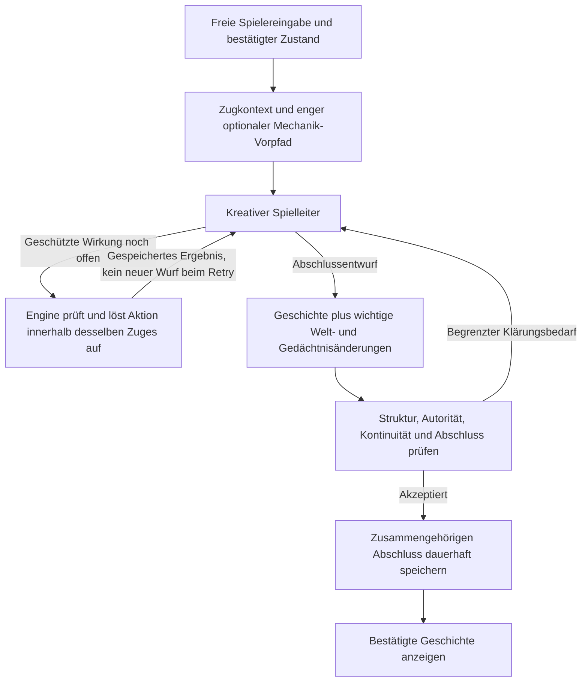

# Neubewertung: LLM als Spielleiter, Engine als mechanischer und persistenter Kern

16.11.2026 · Architekturentscheidung und Prüfungsvorschlag, keine Implementierungsfreigabe.

**Produkt:** `.200`, `0cd14806cd0c7fe2ab0d54b8463c486ee572714b`. **Dokumentationsbasis:** `main`, `e0557a04575baf5874f08248fc22ba363e97af96`. **Experiment:** `80d5fcb8cf799061b7f8ab1842f1258ce9d94f1c`, Draft-PR #20. Alle drei Remote-HEADs und der saubere Main-Checkout wurden geprüft.

Grundlagen sind das [Architekturaudit](ARCHITEKTUR_AUDIT_REDESIGN_ENTSCHEIDUNG_2026-11-16.md), der [Prototypvergleich][vergleich] und gezielte erneute Codelektüre. Narrative Freiheit, Gedächtnis/Autorität und Systemarchitektur wurden unabhängig gegengeprüft und hier zusammengeführt. Keine neue Codeinventur, keine ausgeführten Tests, Modell- oder Provideraufrufe. Frühere Testergebnisse sind vorhandene Evidenz, keine in diesem Auftrag wiederholten Prüfungen. Produkt, Experimentbranch und PR bleiben unverändert.

## 1. Haben wir uns bei der Kontrolle des Narrators zu sehr eingeschränkt?

**Teilweise ja: bei der technischen Vermittlung kreativer Entscheidungen und bei einzelnen bewusst gewählten Spielregeln. Nicht belegt ist, dass der Narrator insgesamt kaum noch eigenständig handeln dürfte.** Die These einer bereits nachgewiesenen passiven oder literarisch schlechteren Welt geht über die vorhandenen Daten hinaus.

Der aktuelle Vertrag sagt ausdrücklich: Außerhalb geschützter Mechanik ist die Engine Kontinuitätsgedächtnis, kein Erlaubnissystem. NPCs dürfen helfen, verweigern, gehen, begleiten, Informationen enthüllen, Gegenstände überreichen und die Welt verändern. Eigenständige Motive, Lügen, Verrat, gewöhnliche neue Personen und Orte sind erlaubt. Hintergrundpersonen müssen nicht zu wichtigen Figuren werden. Das steht in [Narratorvertrag:27–28,65–70,151–185,289][vertrag], nicht nur in einer nachträglichen Interpretation.

Die tatsächliche Reibung besteht darin, dass der GM eine Weltentscheidung zuerst in Prosa trifft, ein weiterer Modellaufruf sie erneut erschließt und die Engine anhand einer Mischung aus Fachregeln, Textbelegen und sprachlichen Mustern entscheidet, ob sie stattgefunden hat. Beispielsweise sucht die Präsenzprüfung nach englischen Klauseln, Negationen, Erinnerungs- und Zukunftsmarkern; legitime Rückkehr und bloße Erwähnung müssen darin unterscheidbar sein ([narration_evidence.js:159–179][praesenz]). Die Unterscheidung ist richtig. Die nachträgliche Rekonstruktion aus Formulierungen ist nur eine mögliche technische Umsetzung.

### Drei unterschiedliche Arten von Kontrolle

| Art | Beispiele aus .200 | Neue Bewertung |
|---|---|---|
| Unverzichtbare Autoritätsgrenze | Keine erfundenen Spielerentscheidungen, Treffer, Würfel, Ressourcen, Käufe, Skills oder freiwilligen Zusagen Alarics; Erinnerung ist keine aktuelle Anwesenheit | Beibehalten. Strukturierte Ausgabe darf diese Grenzen nicht umgehen |
| Bewusste Spielgestaltung | PULSE-Fenster für neue Angreifer; Ankunftsschutz gegen sofortige Beschlagnahme; weitgehendes Sprechverbot im Kampf; keine beliebigen Hooks gegen ruhige Szenen; dauerhafte E3-Anker erst bei späterer Begegnung | Nicht technisch zwingend. Als gesonderte Produktentscheidungen prüfen; nicht stillschweigend entfernen oder als unveränderliche Enginegrundlage behandeln |
| Kompensation der bisherigen Übertragung | Prosa erst schreiben und dann rekonstruieren; wörtliche Übergabe-/Präsenzbelege; große Regelwiederholungen; Korrektur einer bereits sichtbaren Welt | Durch direkte, typisierte Autorenschaft und bestätigten Abschluss möglichst ersetzen. Fachliche Gegenfälle bleiben erhalten |

PULSE ist insbesondere **keine allgemeine Erlaubnis für NPC-Leben**. Ein Thread zum goldenen Licht kann auch bei geschlossenem Fenster gebucht werden; bereits Anwesende behalten ihre Handlungsmöglichkeiten. Neu eintretende Angreifer unterliegen dagegen DANGER-/Gruppen-/Sought-Regeln ([world.js:606–624][pulse]; Testquellen `pulse_a.test.js:293–353`, `pulse_npc_arrival.test.js:54–60`). Das sind Fairness- und Pacingentscheidungen. Schadensberechnung durch die Engine verlangt nicht logisch genau diese Begegnungspolitik.

Auch `policy.js:12–22` entscheidet anhand von Haltung, Verletzung und Rolle, wann ein NPC Gewalt beginnen darf. Das ist mehr als Mathematik. Langfristig sollte der GM plausible Motive und NPC-Entschlüsse verantworten, während ausdrücklich vereinbarte Fairnessregeln und mechanische Auflösung bei der Engine bleiben. Welche heutige Motivschwelle entfällt, ist eine spätere Produktentscheidung, kein Nebenprodukt eines neuen JSON-Formats. Dasselbe gilt für das Kampfsprechverbot und E3-Erhaltungsregeln. Dieser Bericht ändert keine dieser Regeln.

### Was ich an der bisherigen Empfehlung korrigiere

**B bleibt eine brauchbare Übergangs-/Vergleichsarchitektur, ist aber unter dieser Produktvision nicht mehr meine bevorzugte langfristige Modellarchitektur.** Die vorherige Vorsicht war für den unmittelbaren Stabilisierungspfad nachvollziehbar; als allgemeiner Vorrang von Planner–Narrator–Extractor war sie zu weitgehend.

Der C1-Prototyp beginnt weiterhin mit `prepareGenerationAsync(...planner:true)`. Erst danach verbindet er Narration und Weltvorschläge. Er prüft weder einen eigenständigen Spielleiter als erste Sprachinstanz noch dessen Engine-Werkzeuggebrauch ([orchestrator.mjs:25–40][orchestrator], [engine.mjs:19–30][protoengine]). Erfolgsantworten wurden aus vorhandenen Narrations-/Extractorantworten zusammengesetzt. Die beiden synthetischen Fehler zeigen: Exakte Textspans und Domainvalidierung beweisen weder Bedeutungsdeckung noch vollständige Gedächtniseinträge. Sie zeigen **nicht**, dass ein Roleplay-Modell beides nicht gemeinsam erzeugen kann, oder dass B dies natürlicherweise besser erkennt. Ein ebenso falscher Extractor passiert dieselbe Grenze.

Umgekehrt beweisen die 61 technischen Tests und die Scheduler-/Persistenzerfolge keine überlegene Erzählqualität von B. Die alten C1-Prompts enthielten zudem weitgehend die bisherigen Narrator- und Extractorinstruktionen zusammen. Ihre fast unveränderte Gesamtgröße widerlegt keine kleinere, neu entworfene GM-Schnittstelle; sie belegt eine solche Verbesserung allerdings auch nicht.

## 2. Welche Aufgaben müssen Engine und LLM jeweils wirklich übernehmen?

Die zentrale Trennung lautet **Entscheidung über fiktionalen Inhalt**, **Entscheidung über mechanische Wirkung** und **verbindliche Aufbewahrung**. Eine Engine kann eine vom GM erfundene Zusage verbindlich speichern, ohne selbst entschieden zu haben, dass Wat sie machen soll.

| Bereich | Zuständigkeit des LLM | Zuständigkeit der Engine | Grenze |
|---|---|---|---|
| **A – Mechanische Autorität** | Freie Eingabe verstehen, beabsichtigte Aktionen/Targets benennen; erlaubte NPC-Handlungen wählen; Ergebnis ausgestalten | Voraussetzungen, Reihenfolge, Würfel, Checks, Stealth, Treffer/Schaden, Tod, XP, Stats, Skills, Inventar, Geld, Loot und formale Verträge berechnen/validieren/buchen | Kein freies Schreiben geschützter Werte. Ein strukturierter Vorschlag ist kein bestätigter Erfolg |
| **B – Kreative Autorität** | Dialog, Motive, gewöhnliche soziale Reaktionen, Atmosphäre, neue Personen/Orte, Konflikte, plausible offscreen Entwicklungen und Erzähltempo gestalten | Identitäten und etablierten Kanon bereitstellen; explizite Kontinuitäts-/Fairnessregeln durchsetzen | Keine Genehmigung jeder Geste. Keine freiwillige Entscheidung Alarics erfinden; neue Fiktion darf keine versteckte Gratismechanik liefern |
| **C – Dauerhaftes Gedächtnis** | Bedeutende Neuerungen und Veränderungen ausdrücklich kennzeichnen; Wahrheit, Bericht und Vermutung unterscheiden | Stabile IDs, Herkunft, Gültigkeit, Wissenszugang, Historie, Zusagenstatus, Speicherung und relevanten Abruf verwalten | Persistenz ist deterministisch; die Vollständigkeit semantischer Auswahl ist es nicht automatisch |
| **D – Gemeinsame Zuständigkeit** | Ursache und Absicht eines Geschehens erfinden oder interpretieren | Betroffene geschützte Folgen auflösen; abhängige Fortsetzung erst mit Ergebnis zulassen | Nicht jede kreative Entscheidung ist ein Check; jede tatsächlich regelgebundene Wirkung muss durch die Engine |

**Spielerhoheit betrifft freiwillige Entscheidungen, nicht die Abwesenheit widriger Ereignisse.** Ein NPC darf widersprechen, angreifen oder einen Weg versperren. Alarics Antwort, Zustimmung, Einkauf oder freiwillige Flucht darf das Modell nicht hinzufügen. Ein Quellenzitat hilft beim Nachweis der Eingabe, beweist für sich aber weder Zustimmung noch vollständige Interpretation einer Bedingung.

Konkrete gemeinsame Fälle:

- **Bandit greift an:** Der GM wählt den zulässigen Entschluss und die Inszenierung. Die Engine prüft Akteur, Anwesenheit, Begegnungs-/Ankunftsregeln, Initiative und Angriff. Der GM kennt Treffer und Schaden erst danach. Ein Windup kann einen echten Entscheidungspunkt eröffnen; es darf nicht jede tatsächliche Attacke zur folgenlosen Drohung werden, nur um einen Aufruf zu sparen.
- **Überraschendes Geschenk:** Der NPC darf von sich aus schenken. Angebot, Zusage und tatsächliche Übergabe sind verschieden. Gegenstand/Geldmenge und Transfer werden über die bestehende Inventar-/Wirtschaftsautorität validiert und einmal gebucht. Ein erfundener neuer NPC ist kein unbegrenzter Geld- oder Ausrüstungsdrucker. Offizielle Gildenauszahlung bleibt ihr eigener Enginepfad.
- **Verfolgung oder NPC-Flucht:** Der Entschluss ist kreativ; eine umstrittene Flucht, Reichweite, Entdeckung oder Gelegenheit für einen Angriff kann regelgebunden sein. Bloßes Weggehen aus einem friedlichen Gespräch braucht keinen künstlichen Würfel. Alaric verfolgt nicht automatisch.
- **Neuer Ort oder Begegnung:** Name, Aussehen, Bewohner und Konflikt können frei entstehen. Autoritative Position, Wegfolge, Zeit, Zugang, Dungeonidentität und verborgene mechanische Folgen bleiben geprüft. „Ich will in den Wald“ ist noch keine garantierte Ankunft ohne Unterbrechung; genau das unterscheidet bereits `commands.js:734–738`.
- **Soziale Reaktion:** Wat darf aus eigenen Gründen helfen oder sich ärgern. Nur soweit die geltenden Regeln einen erfolgsabhängigen Check vorsehen, muss ein solcher aufgelöst werden. LLM-Empathie wird nicht durch ein universelles soziales Würfelsystem ersetzt.

Für Gedächtnis gelten verschiedene Schwellen: flüchtige Atmosphäre bleibt im bestätigten Erzählarchiv; etablierte orts-/personenbezogene Fakten, relevante neue Identitäten, bedeutende gemeinsame Erlebnisse, Wissen/Glaube, nachhaltige Beziehungen und offene/erledigte Zusagen gehören in abrufbare Struktur. Mechanische Ereignisse kommen unmittelbar aus der Engine und werden nicht nochmals aus Prosa als zweite Zahlenwahrheit erfunden. Eine Namenlose im Hintergrund braucht nicht dieselbe Karte wie eine Frau, die sich vorstellt und morgen Hilfe verspricht.

## 3. Wie sähe die beste Architektur ohne historische Vorfestlegung aus?

**Ich würde einen dynamischen kreativen Spielleiter mit Engine-Werkzeugen und gemeinsam erzeugtem, selektivem Weltgedächtnis wählen.** Normaler Abschluss ist eine zusammengehörige Ausgabe aus Geschichte und bedeutenden Welt-/Gedächtnisänderungen. Bei offener Mechanik fordert derselbe GM deren Auflösung an und setzt mit dem Ergebnis fort. Ein enger deterministischer Vorpfad darf eindeutig bekannte Aktionen bereits erledigen. Separate feste Berufsrollen „Planner“, „Narrator“ und „Extractor“ sind dafür nicht erforderlich.

Planen, erzählen und wichtige Informationen auswählen bleiben Fähigkeiten des Modells. Was entfällt, ist die Annahme, dass diese Fähigkeiten immer drei voneinander getrennte große Modellanfragen benötigen. Das ist eine grundlegende Erneuerung der Modell-/Integrationsarchitektur, kein Neubau der RPG-Mathematik.

### Zielablauf

Werkzeuge sind hierbei keine neue allgemeine Programmiersprache für das LLM. Sie bieten fachliche Operationen wie eine beabsichtigte Handlung auflösen, einen bekannten Gegenstand übertragen oder fehlende kanonische Informationen nachschlagen. Kreative Fakten und Gedächtnis dürfen als Paket entstehen; nicht jede NPC-Geste wird ein Toolcall. Geschützte Zustandsfelder bleiben unbeschreibbar, bis die zuständige Enginefunktion sie erzeugt.

Die Autoritätsquelle muss unterscheidbar sein: **Spielereingabe**, **NPC-/Weltentscheidung des GM**, **bestätigtes Engineergebnis**. Ein Spielerzitat-Guard ist kein fertiger Validator für NPC-Eigeninitiative. Umgekehrt darf der GM eine eigene Entscheidung nicht als Spielerauftrag etikettieren. Tatsächliche Änderungen an der Welt werden erst durch den zuständigen Commit verbindlich; die Engine prüft dabei nicht, ob ihr selbst die kreative Idee eingefallen wäre.

### Vergleich der ernsthaften Alternativen

Gemeinsame Ausgabe, Engineführung und dynamische Aufrufsteuerung sind teilweise kombinierbare Achsen. Die folgenden Varianten unterscheiden sich deshalb im **verbindlichen Ablauf**, nicht in künstlich voneinander isolierten Schlagwörtern.

| Variante | Verbindlicher Ablauf | Stärke | Entscheidender Nachteil |
|---|---|---|---|
| **Gemeinsamer GM, fester C1-Abschluss** | Nach nötiger Vorbereitung Geschichte und Memory zusammen; offene Folgen führen zu Ablehnung/Korrektur | Keine obligatorische Rückübersetzung der ganzen Erzählung | Eine erst im Entwurf entdeckte mechanische Folge kann nicht im selben abgeschlossenen Text schon richtig entschieden sein |
| **Mechanik zuerst, dann GM** | Mechanisch relevante Eingabe vorab strukturieren/auflösen; danach kreativer Abschluss mit Memory | Engineergebnisse liegen vor der Prosa vor; starker Pfad für Kampf und gebundene Aktionen | Beliebigen Freitext sicher vorab einzuordnen benötigt selbst Sprachverständnis. Spontane Weltmechanik bleibt eine zweite Übergangsstelle |
| **Dynamischer GM mit Engine-Werkzeugen – empfohlen** | Direkt abschließen, wenn möglich; ansonsten innerhalb desselben Zuges auflösen, fortsetzen und abschließen | Ein kreativer Verantwortlicher; bedarfsabhängige statt obligatorischer Phasen; freier Weltentwurf und Mechanik können sich abwechseln | Komplexerer interner Zugautomat; gemeinsam erzeugtes Memory und Tooldisziplin müssen praktisch bewiesen werden |
| **B: optionaler Planner, Narrator, Extractor** | Mechanik vorab, freie Prosa, separater Weltleser vor Veröffentlichung | Vorhandene Trennung und nachgeschaltete Erkennung auch nicht ausdrücklich deklarierter Fakten | Mindestens Narration plus Extraktion für freie Weltentwicklung; erneute Interpretation, große doppelte Kontexte; keine garantierte semantische Vollständigkeit |
| **C2: Weltentwurf, Auflösung, Darstellung** | Wichtige Szene zuerst strukturieren, validieren, dann formulieren | Nützlich für eine neu entstehende mechanische Ereigniskette | Als allgemeiner Pflichtpfad zusätzliche Phase; der Renderer kann trotzdem neue ungespeicherte Tatsachen erfinden oder zu stark eingeschränkt werden |

### Gewichtung unter der Produktvision

Die Prioritäten sind Entscheidungsgewichte, **keine gemessenen Qualitätsnoten**: Rollenspielqualität/Freiheit 25 %, langfristige NPC-/Weltkontinuität 20 %, mechanische Korrektheit 15 %, Spielerhoheit 10 %, Modellaufwand/Latenz/Wiederaufnahme 15 %, Promptkomplexität/Wartbarkeit 5 %, Modell-/Providerübertragbarkeit 5 %, Umstellungsrisiko 5 %. Mechanik, Spielerhoheit und belastbare Persistenz sind zusätzlich Ausschlusskriterien: Mehr Spaß darf ihren Verlust nicht rechnerisch ausgleichen.

Der dynamische GM passt am besten zu freier Initiative **mit echter Auflösung**. Festes C1 besitzt denselben Gedächtnisvorteil als Hypothese, aber keinen guten Ablauf für neu auftretende Mechanik. „Mechanik zuerst“ ist dafür kausal übersichtlich, droht jedoch wieder einen großen Vorplaner zu benötigen. C2 macht Entwurf und Ergebnis gut nachvollziehbar, bezahlt dafür auch im einfachen Gespräch zwei kreative Phasen. B hat den geringsten Umstellungsaufwand und erlaubt die Trennung eines reinen Prosa-Modells vom strukturierten Leser; es behält dafür die obligatorische Übersetzung. Bei allen Varianten bleiben semantische Gedächtnisqualität und Agency Modellaufgaben mit Enginegrenzen, keine bereits bewiesenen Garantien.

Die neue Gewichtung bevorzugt **Zielpassung und weniger unvermeidbare Übersetzung** gegenüber Nähe zur vorhandenen Pipeline. Deshalb wähle ich den dynamischen GM trotz höherem Ablauf- und Umstellungsrisiko. Weniger doppelte Rollenregeln können die Wartbarkeit verbessern; Tools und Fortsetzungen erhöhen zunächst die Anforderungen an das Modell und den Koordinator. Dies ist ein Architektururteil, keine aus Offlinefixtures errechnete Überlegenheit. Scheitert gemeinsames Memory im direkten Vergleich, bleibt eine zusätzliche Lesephase zulässig.

### Physische Aufrufe ehrlich zählen

Ein Tool ist lokal kein Modellaufruf; die Modellfortsetzung nach dessen Ergebnis meistens schon. Native Function Calling oder ein SDK-Loop ändert diese Kausalität nicht. Folgende Zahlen sind **analytische fehlerfreie Ablaufbeispiele**, keine gemessene Verteilung oder Aussage „90 % der Züge brauchen einen Request“:

| Situation | Zielvariante | Warum |
|---|---:|---|
| Status-/Systempanel | 0 | Bereits deterministisch darstellbar |
| Gespräch, Wiederbegegnung, neue Zusage ohne offene geschützte Wirkung | 1 | GM kann Geschichte und Memory zusammen abschließen, sofern fälliger Zeit-/PULSE-Kontext bereits feststeht |
| Eindeutig voraufgelöste Aktion | 1 | Ergebnis ist vor dem GM bekannt; sichere Erkennung muss die vollständige Eingabe abdecken |
| Freie, erst vom GM verstandene mechanische Aktion | mindestens 2 | Interpretieren/Tool anfordern → Engine → mit Ergebnis erzählen |
| Unbekannte Reise oder spontane NPC-Eskalation mit erst später feststehender Folge | mindestens 2, gegebenenfalls mehr | Ursache, relevante Dauer/Ort, Wirkung und abhängige Reaktion entstehen schrittweise |
| Unklarer oder unvollständiger wichtiger Weltabschluss | zusätzlich mindestens 1, falls Modellkorrektur erforderlich | Ein zweiter Leser oder korrigierter Entwurf kostet tatsächlich einen Request |

Auch ein Gespräch kann Zeit, PULSE und Erinnerungen erzeugen. Diese dürfen nicht entfallen, um die Ein-Aufruf-Quote zu schönen. Das bisherige `playerTurnV4` bündelt Turnbeginn, Synchronisation, Commands, RNG und Outcome ([turn.js:60–111][turn]). Es darf nicht bei jedem Tool nochmals einen neuen Zug beginnen. Die sichere Aufteilung dieser Funktion in einen fachlich zusammenhängenden Zug ist noch nicht prototypisiert.

## 4. Was würde gegenüber .200 tatsächlich einfacher oder besser?

**Strukturell einfacher:** Eine normale Unterhaltung müsste nicht zuerst ein LLM einen leeren Plan schreiben lassen und später ein anderes LLM die gesamte Erzählung erneut lesen. Der GM erzeugt neue Weltinformation bereits in ihrer vorgesehenen persistenten Form. Neue Rollenregeln werden aus einem Zuständigkeitsvertrag abgeleitet; Zahlen, bestehende Angebote und mechanische Fähigkeiten kommen aus der Engine, nicht aus mehrfach gepflegten Erklärtexten.

**Für Spielspaß plausibel besser, noch ungemessen:** Die Person, die Wat spricht, entscheidet zugleich, welche Zusage er gerade macht. Der GM muss eine gewöhnliche Rückkehr nicht über eine sprachliche Beweisformel für einen späteren Leser absichern. Er darf Nebenfiguren und soziale Folgen frei entwickeln. Weniger feste Übergänge können Dialoge flüssiger machen. Keine dieser Aussagen beweist bereits bessere Prosa, mehr überraschende Szenen oder geringere reale Latenz.

**Technisch bereits im isolierten Modell gezeigt, aber noch nicht produktiv:** Zentraler gewichteter Scheduler, gespeicherte Antworten, idempotente Buchung und Persistenz vor Anzeige. Diese Ergebnisse sind architekturübergreifend. Sie werden nicht ungültig, wenn B als Ziel entfällt. Die 61 Prototyptests, 47 ausgewählten Engine-Regressionen und sechs ST-Quellprüfungen aus `80d5fcb` bleiben genau in ihrem dokumentierten Umfang relevant.

**Nicht automatisch einfacher:** Mehrstufige Engine-Werkzeuge erfordern klare Abhängigkeiten, Begrenzung und Fehlerzustände. Der Prompt kann kleiner werden, aber ein vollständiger Werkzeug-/Lorekatalog kann dieselbe Überlastung wieder erzeugen. Ein GM mit großen gemeinsamen Prompts kann langsamer als zwei gezielte kleine Aufrufe sein. Das erste sichtbare Wort kommt bei bestätigter Veröffentlichung später als bei ungeprüftem Streaming; der Nutzen ist die zusammenhängende, gespeicherte Geschichte.

Der im Audit belegte `.200`-Vorfall bleibt unabhängig von der Modellarchitektur relevant: sichtbare Waldreise ohne Buchung, ungefähr 121 Sekunden Extractorfehler, danach Concurrency-Ablehnungen. Vier aktive plus vier angefragte Kapazitätseinheiten überschritten das Limit vier. Kein Beleg für verbrauchte Credits, Kontext- oder RPM-Limit; die Identität der remote belegenden Anfrage bleibt offen. Weniger Pflichtrequests lösen weder lokale Abbruchsemantik noch externe Accountsessions.

Die Zielarchitektur benötigt deshalb in allen Varianten stabile Turn-/Revisions-/Schritt-/Versuchsbezüge, gespeicherte mechanische Ergebnisse, begrenzte Fortsetzungen und eine gemeinsame Zulassung sämtlicher eigener Modellrequests. Lokal abgebrochen heißt nicht remote beendet. Der konservative Prototyp kann bei unbekanntem Ende dauerhaft blockieren; ein belastbares Betriebsverfahren für echte Providerbestätigung, Reconciliation und explizite Wiederaufnahme fehlt noch. Ein blind freigebendes Timeout wäre kein Fortschritt.

## 5. Welche bisherigen Systeme könnten entfallen oder wesentlich kleiner werden?

| Heutiger Bestandteil | Zielentscheidung |
|---|---|
| Planner als Pflichtrequest für jede freie Eingabe (`runtime.js:673–679`) | Entfällt als feste Phase. Interpretation liegt beim GM oder einem engen sicheren Vorpfad; bei besonderem Bedarf kann eine getrennte Interpretationsphase sinnvoll bleiben |
| Extractor als Pflichtleser jeder narrativen Antwort | Entfällt im Zielnormalfall. Wichtiges Memory wird direkt mitverfasst; zusätzliche semantische Prüfung bleibt gezielt oder bei unzureichender Modellleistung zulässig |
| Lange mehrfach kopierte Narrator-/Planner-/Extractorregeln | Ein kleiner Zuständigkeitskern, situative Fachmodule und kanonisch erzeugte Zahlen/Objektreferenzen. Keine pauschale Streichung der damit geschützten Gegenfälle |
| Prosa als alleiniger Beweis einer kreativen Weltentscheidung | Wird durch ausdrücklich autorisierte GM-Entscheidung mit Identität, Zeit und Quellenbezug ersetzt. Verneinung/Bericht/Hypothese bleiben verschiedene Bedeutungen |
| Optimistische Anzeige mit nachträglicher Weltkorrektur | Ersetzen durch Entwurf, Abschluss und bestätigte Veröffentlichung |
| Getrennte Planner-/Extractor-/Narrator-Retrybesitzer | Ein Request-/Zugkoordinator; keine sich gegenseitig verstärkenden Recoveryketten |
| Heutiger ST-Narrator als alleiniger Besitzer der sichtbaren Generation | Kontrollierter Adapter für interne Generierung und anschließende Veröffentlichung; kein unveränderter MESSAGE_RECEIVED-Nachlauf |
| Kampf, Checks, Progression, Inventar/Wirtschaft, Loot, IDs, Eventfold | Fachlicher Kern bleibt. Schnittstellen gegebenenfalls entkoppeln, keine neue Mathematik |
| Fakten/Behauptungen/Wissen, bedeutende Erinnerungen, Threads, NPC-Karten | Behalten und gezielt an neue Autorenschaft anbinden; keine Rückkehr zu Chatgedächtnis |

`world.js` ist weder komplett wertlos noch unverändert ein fertiger neuer Toolvalidator. Es vermischt wiederverwendbare Fachregeln mit der Annahme, dass eine Prosa bereits vorliegt. Ebenso sind Spieler- und NPC-Autorisierung unterschiedliche Pfade. Diese Naht muss neu entworfen werden; bloß `applyExtraction` in `applyGM` umzubenennen reicht nicht.

PULSE, E2/E3, Board und Forge werden nicht allein durch weniger Modellrollen überflüssig. Inhaltliche Generatoren können später dieselbe Modellinstanz beziehungsweise dasselbe Protokoll verwenden, benötigen aber weiterhin ihre Fachvalidierung und gegebenenfalls einen zusätzlichen Request. Eine neue API darf ihre Kosten nicht verstecken. Eine E4/E5-Agendensimulation ist für diesen Architekturwechsel nicht erforderlich.

## 6. Welche Fähigkeiten oder Garantien könnten verloren gehen?

**Die zweite Leseperspektive.** Ein Extractor kann in Prosa wichtige Tatsachen entdecken, die der schreibende GM nicht selbst als Memory markiert hat. Gemeinsame Autorenschaft vermeidet manche Übersetzungsverluste, kann aber blinde Flecken gemeinsam erzeugen. Ein gelegentlicher zweiter Leser ist deshalb eine zulässige Qualitätsmaßnahme. Dessen Abwesenheit darf erst dann als Normalfall gelten, wenn der direkte Memoryabruf praktisch trägt. Weder B noch zwei Modelle garantieren vollständiges Sprachverständnis.

**Verdeckte Mechanik in Freitext.** „Ich lenke ihn ab und nehme dann den Schlüssel“ darf nicht als harmloser Dialog durchgehen. Ein Modellfeld `no_mechanics` oder `no_memory` ist keine verifizierte Befreiung. Zustands- und Regelprüfungen können erkannte Aktionen absichern; unerkannte Absicht bleibt eine Sprachgrenze. Der bisherige Planner löst dieselbe Art Problem und darf nicht durch einen breiten unsicheren Regexklassifikator ersetzt werden.

**Semantische Konsistenz trotz gültigem JSON.** Das Experiment zeigt eine gebuchte Ankunft bei verneinender Prosa und ein erzähltes Versprechen ohne Thread ([Gegenbeispiele:129–138][gegenbeispiele]). IDs, Textspans und atomarer Save lösen diese Fehler nicht. Für eine neu erstellte Zusage sollte die gemeinsame Ausgabe einen ausdrücklich typisierten Sprechakt/Welteintrag enthalten; sie wird einmal als bedeutender Inhalt verfasst und mit ihrer Darstellung verbunden. Das reduziert Doppelinterpretation. Weitere freie Sätze können dennoch unmarkierte Zusagen enthalten. Keine Garantie behaupten, dass ein vorhandener Link jede fehlende Information erkennt.

**Zwei verschiedene Bestätigungen:** Technisch lässt sich garantieren, dass akzeptierte Daten samt Text vor ihrer Anzeige dauerhaft gespeichert sind. Das beweist nicht, dass sämtliche wichtige Bedeutung erkannt wurde oder die Prosa nirgends dem Zustand widerspricht. Modellverträge, fachliche Prüfungen und empirische Gegenfälle bleiben nötig. Ein zweiter semantischer Prüfer kann Risiken reduzieren, beweist aber keine allgemeine Wahrheit. Ein erkannter wesentlicher Konflikt darf nicht unverändert als Erfolg erscheinen.

**Übertragbarkeit auf RP-Modelle.** Ein sehr guter Prosaerzähler kann bei strukturierten Argumenten oder Fortsetzungen schwach sein. Native Toolunterstützung ist nicht für den vorhandenen GLM-/ST-Pfad nachgewiesen. Ein providerneutraler JSON-Nachrichtenvertrag mit lokalem Validator kann native Tools ersetzen, aber nicht die notwendige Modellkompetenz. Ein einzelnes riesiges Schema ist keine portable Lösung. Wenn ein geeignetes Roleplay-Modell nur mit separater Extraktion verlässlich arbeitet, muss die Architektur diesen bedarfsabhängigen Ablauf erlauben, statt das Modell für eine dogmatische Ein-Call-Vorgabe auszuschließen.

**Weniger sichtbares Streaming und andere Swipes.** Ein interner Entwurf darf sich während der Generierung ändern; endgültige Geschichte erscheint erst nach Save. Fortschrittsanzeige ist möglich, ungeprüfte Weltbehauptungen als fertige Geschichte nicht. Der bisherige Prototyp zeigt bei committed Regenerate/Swipe nur dasselbe Ergebnis erneut; echte alternative Geschichten und darauf aufbauende Folgeturns sind nicht gelöst. Mechanische Ergebnisse dürfen dabei nicht neu gezogen werden.

**Neuer Kontrollaufwand und Migration.** Eine begrenzte Toolschleife ist noch immer ein Kontrollsystem, jetzt an einer begründeten Zuständigkeitsgrenze. Pro Tool `playerTurnV4` erneut aufzurufen würde Turn/Zeit/PULSE/RNG gefährden. Neue Protokollversion, gespeicherte Schritte und wiederverwendete Ergebnisse sind nötig. Beim Umstieg dürfen bereits bestätigte Fakten und Absprachen nicht durch erneute Interpretation alter Chatprosa überschrieben werden. Zunächst kopierte Kampagnen und erhaltene Originale; kein paralleles unkoordiniertes Schreiben von alter und neuer Pipeline. Eine Rückkehr zu B nach Teilauflösung muss dieselben Ergebnisse verwenden, nicht die Aktion wiederholen.

Diese Risiken sind Gründe für einen gezielten Nachweis. Sie begründen nicht, die Rollenaufteilung von `.200` als langfristig unveränderlich anzusehen.

## 7. Wie arbeiten freie NPC-/Weltreaktionen und verlässliches Gedächtnis zusammen?

**Die Engine speichert, was Wat wissen kann und was mit ihm etabliert wurde. Der GM entscheidet daraus, was Wat heute tut und sagt.** Eine relevante Karte ist weder ein Drehbuch noch ein vollständiges Figurenbewusstsein. Nicht gelieferte Information ist dabei kein Beweis, dass sie nicht existiert.

Die vorhandene Grundlage ist stärker, als eine reine „LLM erinnert sich irgendwie“-Architektur: `facts` besitzen Gültigkeitsgeschichte; `claims` können falsch sein; `knowledge` ordnet Figuren Wissen/Glauben samt Quelle zu; `memories` halten Episoden. Bedeutungsschwelle 6 trennt NPC-Kanon von Routine ([knowledge.js:1–9,49–52][wissen]). Promise-/Debt-Threads bleiben identifizierbar und werden erledigt statt bei Bedarf neu erfunden (`threads.js:89,137`). E2/E3 und `.200`-Karten nutzen Identität, bedeutende gemeinsame Erinnerungen, Absprachen und Persönlichkeit. Das soll bleiben.

### Beispiel: Wat und der Furtweg

Der GM erhält Wats Identität, die belegte letzte Begegnung, seine passende Stimme/Eigenart, eine gegebenenfalls offene Absprache und sein hier relevantes Wissen. Er lässt Wat aus eigenem Anlass sagen, morgen den alten Furtweg zu zeigen. Daraus entsteht eine **einseitige NPC-Zusage**, nicht automatisch Alarics Zustimmung, Reise oder formaler Questvertrag. Im Zielvertrag enthält der Eintrag Beteiligte, Inhalt, Zeitpunkt/Bedingung, Status und Herkunft. Bestätigter Text und Thread werden gemeinsam gespeichert. Das heutige Threadmodell hat `open/resolved`; zeitliche Bedingungen stehen gegebenenfalls im Text. Ein vollständiges strukturiertes Verabredungsmodell wird damit nicht als bereits implementiert behauptet.

Beim Wiedersehen nach Kontextverlust soll die Engine diese Zusage wieder liefern. Der GM darf Wat freundlich, widerwillig oder wegen eines neuen plausiblen Problems reagieren lassen; er darf die Zusage nicht beiläufig vergessen. Eine Verhinderung erhält einen begründeten Verlaufseintrag; die Zusage bleibt offen oder wird ausdrücklich erledigt. Persönlichkeit bestimmt die Ausgestaltung, keine automatische Beziehungspunktvergabe oder NPC-Taktikroutine.

### Was gespeichert und getrennt bleiben muss

| Information | Behandlung |
|---|---|
| Einmaliges Räuspern, Wind im Mantel, beiläufige Farbe | Normalerweise kein eigenes Gedächtnisevent; bestätigter Text bleibt als Herkunft archiviert |
| Etablierte Werkstatt, neuer wiedererkennbarer NPC, dauerhaft relevante Eigenart | Kanonischer Eintrag mit ID und Herkunft; spätere Ergänzung statt versehentliche Doppelidentität |
| Gehörtes Gerücht oder Lüge | Aussage/Glaube und Empfänger speichern; nicht automatisch objektive Weltwahrheit |
| Erlebte Gefahr, Hilfe, Verrat | Bedeutende Episode mit tatsächlichen Beteiligten und Wahrnehmungszugang |
| Versprechen, Schuld, offener Konflikt | Eigener dauerhafter Eintrag mit Status und Bezug; nicht allein eine frei fließende Chat-Zusammenfassung |
| Bekanntgewordenes Geheimnis | Informationsübertragung an konkrete Figuren; Gesamtwissen des GM ist kein Wissen aller NPCs |
| Gebuchter Schaden, Zahlung oder Loot | Autoritatives Engineereignis; Erinnerung darf es referenzieren, aber nicht andere Werte erzeugen |

Bei Wissen müssen **„handelt von“**, **„war beteiligt“**, **„hat wahrgenommen“** und **„wurde informiert“** unterscheidbar sein. Auch die aktuelle Engine garantiert das nicht lückenlos: V4 `learn` reicht `how` weiter, aber keinen konkreten Sprecherbezug; `told` ist kein vollständiger Nachweis eines tatsächlichen Informationstransfers (`world.js:1469–1477`, `delta.js:569–599`). `memory.who` bleibt Teilnehmerliste, während Zeugen separat gefiltert werden; `memoriesOf` liest beides (`delta.js:648–653`, `knowledge.js:163–164`). Das sind statische Grenzen, keine hier neu ausgeführten Fehlerfälle. Sie widerlegen jedoch eine pauschale heutige Garantie „NPCs können niemals Metawissen nutzen“.

Drei Leistungen sind getrennt abzunehmen: **richtig aufnehmen**, **dauerhaft erhalten und passend wiederfinden**, **im Dialog richtig verwenden**. Ein Save-Test prüft die dauerhafte Erhaltung; passenden Abruf und richtige Verwendung brauchen eigene Fälle. Das Erzählarchiv sichert Nachprüfbarkeit, ersetzt aber keinen verlässlichen Abruf. Ein späterer Nachtrag repariert keine bereits widersprüchlich gespielte Szene.

### Wenig Promptaufwand ohne Gedächtnisverlust

Vorgepackt werden aktuelle Szene, angesprochene/aktive Personen, relevante gemeinsame Erlebnisse, offene oder gerade erledigte Absprachen, wenige belegte Persönlichkeitsanker und wirklich erforderliche Mechanik. Kanonische Zahlen stammen aus Content/Ergebnissen. Weitere Erinnerung kann gezielt nachgeladen werden; dafür notwendige Modellfortsetzungen zählen als Kosten. Alte Erstellungshinweise und globale Handels-/Skillkataloge gehören nicht routinemäßig in jedes Waldgespräch.

Die bestehende Karte ist ausdrücklich nur relevanter Auszug (`context.js:703`); sie begrenzt offene Absprachen und kürzt Inhalte (`context.js:149–171,1001–1033`). Knappheit darf nicht als „Wat weiß sonst nichts“ missverstanden werden. Hohe Kontinuitätsrelevanz ist ein Grund, einen ganzen Eintrag bereitzustellen, statt ihn für dekorative Beschreibung abzuschneiden.

Ein gemeinsamer GM kann trotz sauberer Karten Geheimnisse zwischen Figuren vermischen, weil er mehrere Perspektiven sieht. Quellenmarkierungen und getrennte Wissensansichten helfen, erzwingen aber keine semantische Isolation innerhalb eines Modells. Für besonders kritische Geheimnisszenen kann ein zusätzlicher begrenzter Perspektivaufruf sinnvoll sein. Ein Modell pro NPC oder ein ständig laufender Agentenschwarm ist dafür weder erforderlich noch empfohlen.

## 8. Welche Architektur sollte als Nächstes prototypisiert werden?

**Ein schmaler dynamischer GM-Durchstich auf dem vorhandenen Kern, nicht noch einmal C1 als Zusammenkleben der alten Promptphasen.** Er soll genau die bislang fehlende Frage testen: Kann derselbe kreative Verantwortliche frei entscheiden, erforderliche Mechanik rechtzeitig anfordern und die wichtige Erinnerung zum eigenen Text mitliefern?

Die kleinste sinnvolle technische Probe umfasst vier kurze Situationen mit identischen Ausgangszuständen und Wissensgrundlagen:

1. **Wat-Zusage und Wiedersehen:** Gedächtnis gemeinsam liefern, den alten Dialog aus dem aktiven Kontext entfernen, später die Zusage samt Stimme und Wissen wiederfinden. Gegenfälle: ausgelassene Zusage, einseitiges NPC-Versprechen als erfundene PC-Zustimmung, fremdes Geheimnis.
2. **Unbekannte Waldreise:** Kein vorgetäuschter Fastpath; tatsächliche Bewegung, Unterbrechung, Ortsneuschöpfung und Zeit/PULSE müssen zur erzählten Folge passen. Verneinte Ankunft trotz positivem Feld bleibt ein Gegenfall.
3. **Gemischte Spielerhandlung:** Zum Beispiel Ablenkung und bedingte Schlüsselentnahme; Engineergebnis vor abhängiger Fortsetzung. Negation, Bedingung und nicht erklärte freiwillige Folgehandlungen bleiben geschützt.
4. **NPC-Eigeninitiative mit Mechanik:** Etablierter Akteur greift an oder gibt einen gebundenen Gegenstand; neuer Eintritt als Gegenfall. Gespeichertes Toolergebnis plus Timeout vor Fortsetzung darf keinen zweiten Wurf, Transfer oder PULSE erzeugen.

Zunächst **offline mit gekennzeichneten geskripteten Antworten**: gemeinsamer Abschluss, Engineanforderung, Fortsetzung, Gegenfälle, Wiederaufnahme. Gleiche bestehenden Fachregeln für alle Varianten; keine gleichzeitig geänderten PULSE-Chancen, NPC-Stärken oder Lootwerte. B dient als Vergleich für dieselben Bedeutungs- und Gedächtnisanforderungen, der alte C1-Befund als Gegenbeispielbasis. Der vorhandene Scheduler und das Journal liefern Bausteine, aber noch keinen fertigen Tool-Zugautomaten.

Dieser Offlineprototyp kann Ablauf- und Autoritätsfehler falsifizieren. Er kann **nicht** zeigen, wie gut ein Roleplay-Modell eigenständig den Vertrag erfüllt. Dafür ist nach separater Freigabe eine kleine natürliche Vergleichsprobe notwendig: dieselben vier kurzen Verläufe mit B und dem dynamischen GM, einschließlich späterer Erinnerung ohne ursprünglichen Dialog. Keine vorgebauten gemeinsamen Erfolgsantworten. Zunächst Falsifikationsprobe, keine statistische Qualitätsnote; bei Bedarf erst danach breiter vergleichen. Solche Aufrufe werden in diesem Auftrag ausdrücklich nicht durchgeführt.

Gemessen werden tatsächliche Requests samt Fortsetzungen, Repairs und Zusatzlesern; vollständige Prompt-/Outputusage, sofern verfügbar; Zeit bis bestätigter Anzeige; erhaltene Handlungsteile; Welt-/Textwidersprüche; spätere Erinnerung und Wissensgrenzen sowie menschlich beurteilte Freiheit, Eigeninitiative und Erzählfluss. **RNG-/Geld-/Inventargleichheit gilt für identische festgelegte Aktionen und Wiederaufnahmekontrollen.** Natürlich verschiedene zulässige GM-Entscheidungen dürfen andere Folgen haben; dort zählen korrekte Auflösung und Einzelbuchung statt identischer Endzustände. Ein akzeptierter, aber widersprüchlicher Kandidat zählt als Fehler.

Die Entscheidungsschwellen sind inhaltlich klar: Keine doppelte Mechanik oder erfundene Spielerentscheidung; wichtige Memoryinhalte müssen nach Kontextverlust abrufbar bleiben; zusätzliche Aufrufe dürfen nicht verschwiegen werden. Schafft das Modell gemeinsame Erinnerungen nicht ausreichend, wird ein gezielter zweiter Leser ergänzt. Braucht eine Szene erst Weltentwurf, dann Auflösung und Darstellung, ist das ein erlaubter C2-artiger Ablauf innerhalb des dynamischen Modells. Ein weiterer universeller C2-Pflichtprototyp ist derzeit nicht der vorrangige Erkenntnisgewinn.

## 9. Sollte der ST-Hostdurchstich weiterhin stattfinden oder angepasst werden?

**Ja, aber als architekturneutraler Veröffentlichungs-/Fortsetzungsadapter, nicht als nächster Ausbau der festen B-Pipeline.** Die Zieländerung beseitigt den Hostbedarf nicht: Jede Variante muss verhindern, dass eine ungespeicherte Waldreise schon als abgeschlossene Geschichte erscheint.

Die vorhandene ST1.19-Quellprüfung belegt Raw-Generierung ohne Chatappend, explizite `chatData` beim Save und die frühe Anzeige im normalen Streamingpfad. Der Mock belegt kontrolliertes Puffern, Save/Read-back und danach Anzeige. Das sind belastbare Ansatzpunkte, aber keine tatsächliche Browserabnahme, keine Windows-Persistenzgarantie und kein Nachweis nativer Tools beim konkreten Provider ([ST-Nachweis][stnachweis]). Ein einfacher später MESSAGE_RECEIVED-Hook genügt bei Stock-Streaming nicht.

**Empfohlene Reihenfolge:** Erst den kleinen offline GM-/Engine-Fortsetzungsvertrag festlegen und erproben; danach denselben Vertrag im isolierten echten ST-Browser mit Mockprovider durchspielen. Requeststeuerung und Zurückhaltung gehören dabei zum gemeinsamen Fundament. Zu prüfen sind insbesondere Stop/Chatwechsel während eines Engine-/Modellschritts, Reload, Fehler vor/nach Save, einmalige Anzeige, unvollständige Tools/JSON, Fortsetzungszuordnung und alternative Swipe-/Regenerate-Revisionen. Keine persönliche ST-Installation verwenden.

Die spätere natürliche Modellprobe beantwortet eine andere Frage als der Hosttest und bleibt unverzichtbar für Qualitätsbehauptungen. Der Hostdurchstich darf klein bleiben und mit Mockantworten unabhängig davon laufen. Er soll keine monatelange Infrastrukturarbeit vor dem entscheidenden GM-/Memory-Nachweis auslösen. Umgekehrt darf eine schöne natürliche Szene nicht als Ersatz für kontrollierte Veröffentlichung gelten.

Falls native Tools über ST nicht zuverlässig transportiert werden, ist ein einfacher strukturierter Nachrichtenvertrag eine ernsthafte Alternative. Er muss Toolargumente, Ergebnisbezug, Fehler und Requestzählung erhalten. Ein ST-Core-Fork ist bisher weder als nötig noch als unnötig bewiesen. Den heutigen generierenden und sichtbaren ST-Pfad unverändert weiterzuverwenden ist dagegen mit der gewünschten Veröffentlichungsschranke nicht vereinbar.

## 10. Abschließende Architekturentscheidung

**Wenn ich heute mit dem vorhandenen mechanischen und persistenten Avereth-Kern beginnen würde, würde ich keine grundsätzlich dreistufige Planner–Narrator–Extractor-Pipeline bauen. Ich würde einen kreativen Spielleiter mit bedarfsgerechtem Engine-Werkzeuggebrauch und direkt mitverfasstem Weltgedächtnis bauen.**

Die Engine nimmt ihm Rechnen, Würfeln, verbindliche Ressourcenverwaltung und langfristiges Aufbewahren/Abrufen ab. Sie soll nicht an seiner Stelle entscheiden, welche gewöhnliche menschliche Reaktion interessant und plausibel ist. Ein zulässiger NPC-Entschluss braucht einen klaren Weg zu Mechanik und Erinnerung, keine flächendeckende Vorautorisierung jeder kreativen Einzelheit.

| Entscheidungsebene | Festlegung |
|---|---|
| **Langfristiges Ziel** | Dynamischer GM; gemeinsamer narrativer/gedächtnisbezogener Abschluss; zusätzliche Sprachphasen nach tatsächlichem Bedarf |
| **Technisch erforderliche Grundlage** | Deterministischer Kern, getrennte Autoritätsquellen, stabile Identitäten, dauerhafter Zug-/Schrittbezug, gewichtete Requeststeuerung, Wiederaufnahme ohne Neubuchung und bestätigte Veröffentlichung |
| **Noch unbewiesene Annahmen** | Qualität gemeinsamer natürlicher Memoryerzeugung; zuverlässige Wahl nötiger Engineaufrufe; ausreichende Modell-/Providerunterstützung; reale Latenz-/Promptverbesserung; echte ST-Lifecycle-/Swipeintegration |
| **Nächster konkreter Nachweis** | Kleiner isolierter dynamischer GM-/Engine-Durchstich mit den vier Fällen aus Abschnitt 8; danach angepasster ST-Mockprovider-Browserdurchstich und separat freigegebene natürliche Vergleichsprobe |

Damit ändere ich die frühere langfristige Präferenz **B** ausdrücklich. Ich übernehme aus ihr die bewährte gemeinsame Steuerung und Persistenz, nicht die feste Modellrollentrennung. Die beiden C1-Gegenbeispiele bleiben verpflichtende Fehlertests, kein Grundsatzurteil gegen kreative strukturierte Ausgabe. Ein bedarfsabhängiger zweiter Leser oder eine Weltentwurfs-/Renderfortsetzung ist mit der Zielarchitektur vereinbar; dogmatisch ein einziger Request wäre es nicht.

Die Entscheidung ist eine klare Entwicklungsrichtung, **keine Freigabe einer bereits bewiesenen Produktarchitektur**. Am Ziel wird sie daran gemessen, ob sich das Spiel frei und lebendig anfühlt, wichtige Zusagen und Weltfolgen Bestand haben und die Engine zuverlässig genau die Aufgaben übernimmt, für die sie gebaut wurde.

[vergleich]: https://github.com/Mango1331/Claude-AI-RPG-Game/blob/80d5fcb8cf799061b7f8ab1842f1258ce9d94f1c/recherche/ARCHITEKTUR_PROTOTYP_B_C1_VERGLEICH_2026-11-16.md
[vertrag]: https://github.com/Mango1331/Claude-AI-RPG-Game/blob/0cd14806cd0c7fe2ab0d54b8463c486ee572714b/avereth-engine/content/narrator/Avereth_Narrator_Contract_v4.txt#L15
[praesenz]: https://github.com/Mango1331/Claude-AI-RPG-Game/blob/0cd14806cd0c7fe2ab0d54b8463c486ee572714b/avereth-engine/src/v4/narration_evidence.js#L159
[pulse]: https://github.com/Mango1331/Claude-AI-RPG-Game/blob/0cd14806cd0c7fe2ab0d54b8463c486ee572714b/avereth-engine/src/v4/world.js#L603
[orchestrator]: https://github.com/Mango1331/Claude-AI-RPG-Game/blob/80d5fcb8cf799061b7f8ab1842f1258ce9d94f1c/experiments/architecture201/orchestrator.mjs#L25
[protoengine]: https://github.com/Mango1331/Claude-AI-RPG-Game/blob/80d5fcb8cf799061b7f8ab1842f1258ce9d94f1c/experiments/architecture201/engine.mjs#L19
[turn]: https://github.com/Mango1331/Claude-AI-RPG-Game/blob/0cd14806cd0c7fe2ab0d54b8463c486ee572714b/avereth-engine/src/v4/turn.js#L60
[gegenbeispiele]: https://github.com/Mango1331/Claude-AI-RPG-Game/blob/80d5fcb8cf799061b7f8ab1842f1258ce9d94f1c/experiments/architecture201/prototype.test.mjs#L129
[wissen]: https://github.com/Mango1331/Claude-AI-RPG-Game/blob/0cd14806cd0c7fe2ab0d54b8463c486ee572714b/avereth-engine/src/knowledge.js#L1
[stnachweis]: https://github.com/Mango1331/Claude-AI-RPG-Game/blob/80d5fcb8cf799061b7f8ab1842f1258ce9d94f1c/experiments/architecture201/results/st119-source.json
