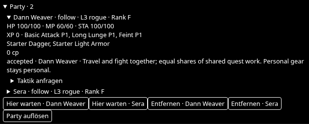

# Avereth .266 · Usertest 18, Party und Weltübernahme

**Der archivierte Spielstand ist am Mühlenteich fortsetzbar.** In SillyTavern 1.19 genügten das Entfernen der späteren Nachrichten und eine kleine Bearbeitung der vorhandenen Ankunftsantwort. Genau eine erneute Extraktion stellte vier individuell anwählbare Echsen her. Nach Speichern und Neuladen standen Dann und Sera weiterhin bei Alaric, mit derselben Quest und Ausrüstung. Für den nächsten persönlichen Spieltest steht der unabhängige GPT-Diffreview aus.

## Produkt und Quellen

| Stand | Commit |
|---|---|
| Ausgangsprodukt .265 | [9dde24a5337e2b43dd4e2d58db45a19d4e7baa89](https://github.com/Mango1331/Claude-AI-RPG-Game/commit/9dde24a5337e2b43dd4e2d58db45a19d4e7baa89) |
| .266, Weltübernahme, Einladungen, Kontext und HUD | [8dca296f393b7df58b5789399acb2579ca79c89b](https://github.com/Mango1331/Claude-AI-RPG-Game/commit/8dca296f393b7df58b5789399acb2579ca79c89b) |
| .266, Kampftaktik, Regressionen und Host-Abnahme | [f87a893240e766ccf2944656138f0fd7ccb0a983](https://github.com/Mango1331/Claude-AI-RPG-Game/commit/f87a893240e766ccf2944656138f0fd7ccb0a983) |
| .266, geprüfter Endstand mit aktiver HUD-Taktik im Kampf | [89a0989fa40f39e909044c79f420cda136cf78fc](https://github.com/Mango1331/Claude-AI-RPG-Game/commit/89a0989fa40f39e909044c79f420cda136cf78fc) |

Alle drei .266-Commits wurden auf dem bestehenden Entwicklungsbranch gepusht und per Remote-Abfrage bestätigt. Dokumentationsbasis war `9cc4977af00a8e5395edb064aaf723f555c067f1`. [Vollständiger Produktdiff .265 → .266](https://github.com/Mango1331/Claude-AI-RPG-Game/compare/9dde24a5337e2b43dd4e2d58db45a19d4e7baa89...89a0989fa40f39e909044c79f420cda136cf78fc)

Chat, Eventexport und redigiertes ST-Log wurden aus Upload 3 rekonstruiert und gegen die veröffentlichten SHA-256-Werte geprüft. Der Quellenadapter ordnete 37 physische Helferantworten den gespeicherten Eingaben und Antworten zu. Auf .265 ergaben 25 von 27 Verarbeitungsfolgen direkt denselben normalisierten Ereignisstrom. In M17 und M19 enthielt jeweils nur die neu erzeugte Einladungs-ID den Hash des zeitlich abweichenden Replay-Präfixes. Nach Ersetzen genau dieser ID an Abrede und Mitgliedschaft stimmten auch diese beiden Folgen vollständig überein. [Originale und Reviews](../testrun_10b/user-20261128-163231-265/README.md) · [Prüfsummen](../testrun_10b/user-20261128-163231-265/source_checksums.json) · [Claude-Gegenreview und Gegenproben](AVERETH_USER18_265_CLAUDE_GEGENREVIEW.md)

## Was sich im Spiel ändert

| Paket | Ursache, Änderung und Gegenprobe |
|---|---|
| AP1 · Sichtung | Ein gesetztes `across` wählte bisher auch im Freien den Handler für den reservierten Dungeon-Slot. Jetzt entscheidet die vorhandene Living-Dungeon-Identität am Standort oder am tatsächlich angesteuerten Zugang. Am Mühlenteich entstehen auf die unveränderte T10-Antwort vier erwachsene Tiere der örtlichen Population, alle auf SHORT. Die größere vernarbte Echse hat eine eigene ID. T11 erhält dieselben vier IDs. Die bekannten anderen Dungeons der Kampagne stören die Sichtung nicht. Coldwell M36 aus der .263-Serie erzeugt jetzt den Bären samt Wahrnehmung und Position. .265 verwarf dort alle drei Meldungen. Die bestehenden Prüfungen für Schwellen, Slot, Anzahl, Individuen, Distanz und Population bleiben auf ihrem zuständigen Pfad. |
| AP2 · Gespräch | Nicht darstellbare optionale Taktikvorschläge können aus dem Plannerbericht entfallen. Eine ausbleibende Buchung erfüllt keine Voraussetzung eines späteren Schritts. M21 erreicht die lokale Annäherung ans Osttor. M23 bucht die vom Planner behauptete Hälfte für Sera nicht. M29 und M32 lassen die Gefährten über den Hinterhalt sprechen. Keiner dieser Züge erzeugt Angriff, Hinterhaltbonus, Zahlung oder taktische Zusage. Bei einer ausdrücklichen Sondervergütung greifen die Belegprüfungen. Für eine unterstützte Spieleranfrage entfällt der zweite Abgleich des Tätigkeitsverbs. Die Identität des angesprochenen Partners und des Ziels, Verneinung, vereinbarte Befugnis und NPC-Entscheidung bleiben relevant. Eine synthetische Variante des User14-Gruppenkampfs führte den gültigen Angriff mit und ohne unbuchbare Begleitanfrage aus. Trefferrecords, RNG und Partystand stimmten überein. |
| AP3 · Einladung | In M15 fiel die freie Einladung an zwei Personen neben der HUD-Questannahme durch den früheren Einzelaktionspfad. Der gemeinsame Befehlsablauf übergibt jetzt jede ausführbare Einladung am tatsächlichen Sequenzplatz an die bestehende Rekrutierung. Individuelle Entscheidungen und Profilziehungen werden im selben Nachrichtenrecord gespeichert. Der zweite Helfer sieht die bis dahin gebuchte Welt. Im Originalplan bestätigt erst der Clerk die Quest. Dann antworten Sera und Dann. Zwei synthetische Zusagen ergeben zwei Mitgliedschaften. Bei Seras Ablehnung tritt nur Dann ein. Offene Gegenforderungen bleiben Angebote. Ein abhängiger Schritt nach fehlgeschlagener Questannahme erzeugt weder Helferaufruf noch Vergütungsanspruch. Auch die native Mehrfachauswahl nutzt denselben Einzelpfad. |
| AP4 · Verlauf und Kontext | Ein fehlgeschlagener Planner mit leerem Ereignisrecord und sein zugehöriger Systemhinweis werden aus der an ST übergebenen Historie gefiltert. Der sichtbare Chat bleibt lesbar. Der vorhandene priorisierte Gefährtenkopf nennt auch Reisemodus und Kampfbereitschaft. Ausführliche Boardanweisungen kommen bei Hallen-, Gilden- oder Auftragsbezug. Die eigene aktive Questbeschreibung und die Nachweis- und Abgaberegeln bleiben verfügbar. Beim Beobachten am Teich enthielt der abgefangene Narratorrequest Dann, Sera, Kampfbereitschaft und den Jagdauftrag. Die Boardbelehrung und die absichtlich in das kurze Verlaufsfenster gesetzte fehlgeschlagene Originaleingabe M21 fehlten. Das Kontextbudget wurde beibehalten. |
| AP5 · Board | Bei genau einem DEFEAT-Ziel darf die Formatnormalisierung das zusätzliche, identische Ortsfeld aus dem Habitat entfernen. Die erste Originalantwort M13 liefert vier gültige Listings ohne den zweiten Boardaufruf. Das fünfte Listing scheitert weiterhin am Levelbereich des Keilers. Ein widersprüchlicher Habitatort besteht die Gegenprobe nicht. Die bestehende Mindestanzahl entscheidet weiterhin über die Annahme des Boards. |
| AP6 · HUD | Eine gemeinsame aufklappbare Partyzeile ersetzt den Dialog. Pro Mitglied lassen sich Profil, Ressourcen, Ausrüstung, Skills, Reiseabrede und Taktik öffnen. Anwesende Kandidaten lassen sich mit einem Klick gesammelt einladen. Der Helfer entscheidet pro Person. Eine freiwillige Taktikanfrage enthält Mitglied, Priorität und gegebenenfalls eine auswählbare Ziel-ID. Die Engine akzeptiert nur die Entscheidung des bezeichneten Partners für genau die aktuelle Anfrage. Organisationssperren sind sichtbar. Im eigenen regulären Kampfzug ist die alleinige Taktikanfrage ausdrücklich mit Abwarten beschriftet. Im autonomen Kampf entsteht kein regelmäßiger zusätzlicher Aufruf. Front ist die normale Ausgangsposition, independent ersetzt eine Ziel- oder Schutzpriorität, Wache kann Erholung kosten. Ein Wachbonus ist nicht belegt. |
| AP7 · Card | Der Dateivergleich mit A.txt aus dem A/B-Test ergibt nach Austausch genau der Revisionszeile Bytegleichheit. In ST wurde die komplette ausgelieferte Beschreibung nach der normalen Auflösung von `{{user}}` verglichen und im Narratorrequest genau einmal gefunden. Die Karte wurde als aktuell erkannt. |
| AP8 · Fortsetzen | Im isolierten Originalchat wurde ab M29 über die ST-Nachrichtenlöschung gekürzt und M28 über den normalen Editor gespeichert. Eine Archivantwort für X, keine Neugenerierung der Erzählung. Dieselben Questdaten und derselbe Charakterbogen einschließlich Geld und Ausrüstung, derselbe Partystand, derselbe Ort und dieselbe Uhrzeit vor und nach der Bearbeitung. Reload buchte nichts nach. |

## Abnahme und Aussagegrenzen

- **Node:** 3.674 Tests bestanden. Sieben gezielte Original- und Variantenprüfungen scheiterten auf .265 und bestanden auf .266. Darunter sind der tatsächliche M15-Plan samt HUD-Bindung, eine abhängige Sonderabrede, M21/M23/M29/M32, die ursprüngliche Boardantwort, T10/T11 und der Verlauf nach Reload. Bei der abhängigen Sonderabrede war die rote Abweichung der unnötige Planner-Retry. Eine unberechtigte Zahlung auf .265 wurde dadurch nicht nachgewiesen. Die alten NPC-Kartenvergleiche prüfen weiterhin den vollständigen historischen Byteinhalt. Für diesen alten Vergleich wird der ehemals immer vorhandene Gildenkontext durch eine explizite Gildeninteraktion hergestellt. Die Outdoor-Gegenprobe prüft den neuen Auswahlpfad separat.
- **Historisch:** 2.235 Fälle gegen das bestehende Manifest, darunter 1.392 bereits zugelassene historische Unterschiede. Keine neue Abweichung, kein geänderter historischer Fingerprint.
- **Modern:** 298 Vergleiche gegen .265. Alle mechanischen Output- und Welthashes stimmen überein. 133 Fälle ändern mindestens einen Request. Im Vergleich ändern sich 126 Planner-, 10 Planner-Repair-, 95 Narrator- und 6 Party-Helfer-Promptfingerprints. In Heron #115 genügt der erste Boardbericht, bei identischem Ergebnis bleibt die aufgezeichnete zweite Boardantwort unbenutzt. Die fallweise geprüfte Manifestergänzung bindet an das .265-Manifest. Die sechs bereits unvollständigen physischen Pfade AA #43, AI #15, Ember #15, Quill #86 und Rook #7/#15 bleiben als solche ausgewiesen.
- **Originalkette:** Alle 27 gespeicherten Schritte wurden auf .266 durchlaufen. Eine reine Aufzeichnung hat an M15 keine zwei zeitlich passenden Helferantworten. Diese Lücke wurde zusätzlich in einer separat gekennzeichneten Kette mit zwei synthetischen Zusagen und in einer Variante mit Seras Ablehnung geprüft. Die späteren nativen Einzeleinladungen werden überflüssig, wenn beide bereits beigetreten sind. Das Originalboard und die ursprünglichen M21-/M32-Pläne brauchen ihre aufgezeichneten Folgeantworten nicht mehr. Die Ketten enden am Teich bei Minute 670 ohne Foldfehler. Die archivierte Prosa bleibt Originaltext, auch wenn sie nach einer veränderten Entscheidung anders ausfallen dürfte.
- **Party-, Finanz- und Kampfregression:** User14 mit Ossen, falscher Sprecher, geänderte Vergütung, individuelle Gegenstands-ID, Zahlungen auf bestehende Ansprüche, Gruppenkampf, Flucht, Teilfrieden und User13-Kapitulation geprüft. Der bestehende Offline-Kampagnenpfad reicht bis zur Questabgabe und Abrechnung. Die freiwillige Standardgleichteilung wurde nicht geändert.
- **SillyTavern 1.19, isoliertes Profil und lokaler Mock:** 66 von 66 Prüfungen bestanden. Neben der fortgesetzten User18-Kopie waren Einzel- und Mehrfacheinladung, Taktik, freier Kampf, Teilfrieden, Swipe, Reload, Eingabe per Enter und Senden sowie der tatsächlich zugestellte Narratorkontext Gegenstand der Prüfung. Die erste Kampfprobe deckte auf, dass der native Handler nur im Erzählmodus erreichbar war. Nach der Korrektur speicherte dieselbe Aktion im Kampf Ossens Zustimmung zu `protect pc`, Alarics einen `hold` und Ossens eigenständigen Angriff. Der Mock verzeichnete einen Party-Entscheid, eine Narration und eine Extraktion.
- **Natürliche Modellqualität:** Keine neuen Provideraufrufe, Kosten 0 USD. Ob ein Modell nach freiem taktischen Gespräch die Antwort der Begleiter natürlich formuliert und im späteren Kampf konsistent weitererzählt, bleibt offen. Falls der Diffreview dafür einen Live-Test verlangt, bietet sich ein zusammenhängender Weg vom Gildenboard über zwei Einladungen bis zum Teich und zum ersten Kampf an. Vorschlag für eine gesonderte Freigabe wäre eine harte Gesamtgrenze von 0,10 USD. Der archivierte User18-Originalrun selbst enthält keinen abgeschlossenen Partykampf.

Dann Weaver ist im Originalsave mit vollem Namen bekannt. Das gespeicherte `known_name: null` trägt hier genau diese Bedeutung.

Der frühere Boardaufbau beim Eintreffen in der Gilde und Gerüchte als Inspiration sind offene Ideen. Der folgenlose Lern-Claim, zusätzliche Wachvorteile und komplexe Kampfskripte blieben außerhalb des Pakets. Eine nachträgliche Gegner-Nachmeldung ist für die Wiederaufnahme nicht erforderlich.

## Installation und Fortsetzung des persönlichen Spielstands

1. Den vorhandenen installierten Extensionordner `avereth-engine` durch die vollständige Version .266 vom Entwicklungsbranch ersetzen, einschließlich `src/ui_party.js`, `style.css` und `content/commands.json`. In der tatsächlich verwendeten Charakterkarte ausschließlich **Description** durch den vollständigen Inhalt von `content/narrator/Avereth_Narrator_Contract_v4.txt` aus demselben Build ersetzen und die Karte speichern. Preset, Lorebook, Regex und die übrigen Kartenfelder brauchen keinen Austausch.
2. SillyTavern neu laden und im Engine-Status Build .266 sowie den aktuellen Narrator Contract prüfen. Den Originalchat sichern, dann die Kopie mit Dann und Sera öffnen.
3. Die Ankunftsantwort am Mühlenteich behalten. Sie beginnt mit **“Then we'll open the dance.”** und endet mit Danns Frage zu den vier Echsen. Über das ST-Menü **Nachrichten löschen** die erste darauffolgende Nachricht auswählen (M29 in der Archivzählung). Alles von dort bis zum Ende löschen, einschließlich des späteren Beobachtungszugs. Warten, bis die Ankunft die letzte Nachricht ist.
4. Den Stift an dieser letzten **Narratorantwort** wählen. Eine kleine echte Textänderung vornehmen. Getestet wurde der Austausch von `held still a moment` gegen `held still for a moment`. Mit dem Häkchen speichern und den Weltabgleich abwarten.
5. Prüfen, dass vier Echsen als Ziele erscheinen, Dann und Sera mitreisen, die Gnasher-Quest aktiv ist und die Uhr **11:10** zeigt. Im geprüften Save hatte Alaric **30 cp, 80 HP, 72 MP und 100 STA**. Danach kann der Spieler selbst über Beobachtung, Gespräch oder Angriff entscheiden.

Die Bearbeitung verwendet die vorhandene Erzählung erneut und benötigt im geprüften Fall nur X. Ein Swipe kann eine neue kostenpflichtige Narration und anschließend eine Extraktion auslösen. Die tatsächliche Antwort des persönlichen Providers ist offen. Die Abnahme verwendete die archivierte T10-Antwort.

## Dateien im vollständigen Produktdiff

Alle Pfade relativ zu `avereth-engine/`.

| Bereich | Dateien |
|---|---|
| Build und Modellverträge | `manifest.json`, `package.json`, `src/util.js`, `content/commands.json`, `content/narrator/Avereth_Narrator_Contract_v4.txt` |
| Welt, Aktionen, Kampf und Kontext | `src/v4/world.js`, `src/v4/guild.js`, `src/v4/planner.js`, `src/v4/commands.js`, `src/v4/turn.js`, `src/v4/runtime.js`, `src/v4/party_actions.js`, `src/party.js`, `src/engine.js`, `src/context.js`, `src/host.js` |
| Bedienoberfläche | `src/action_composer.js`, `src/ui_party.js`, `style.css`, `docs/HUD_STYLE.md` |
| Prüfungen und Messdaten | `tests/replay/user18/original.json.gz`, `tests/replay/user18_266.test.js`, `tests/v4/npc_e3_compact.test.js`, `tests/replay/modern/party266.json`, `tools/replay/build_modern.py`, `tools/replay/modern.mjs`, `tools/st_live/party217_smoke.mjs` |
